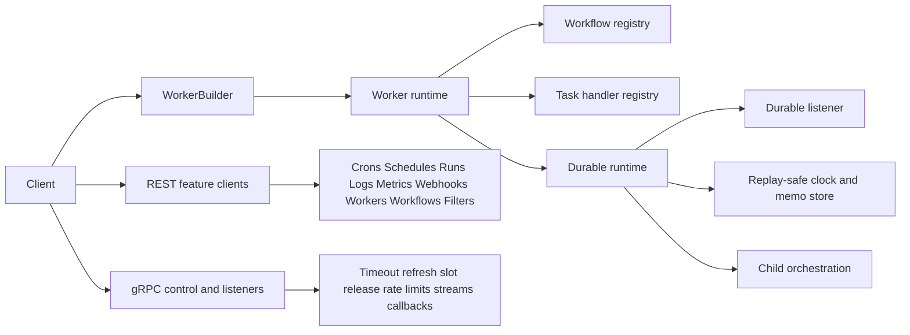
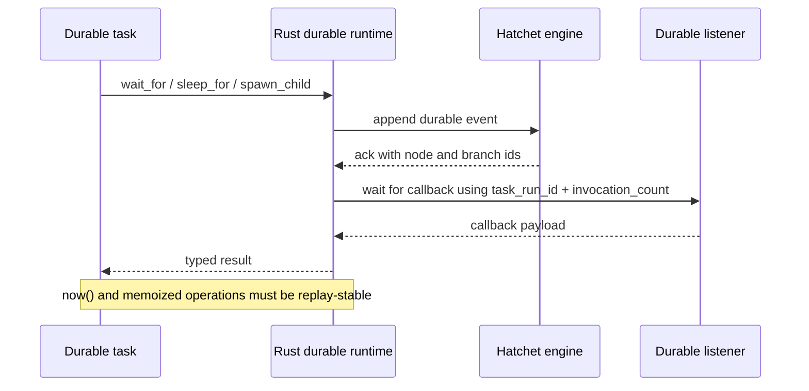

# Idiomatic Rust Design for the Hatchet SDK

## Executive summary

A Rust SDK with behavioral parity to the current TypeScript SDK is feasible, but it is not a “mechanical transpile” project. The public TypeScript source and docs already expose the important surfaces: the top-level client; workflow, task, and durable-task declaration layers; run options; worker creation; feature clients; the runtime `Context`; and the durable runtime API, including replay-aware time, durable sleep, wait conditions, event waits, and child spawning. That makes the spec legible enough to design a Rust SDK without depending on an unofficial Rust implementation. citeturn18view0turn18view1turn18view3turn18view5turn17view0turn17view1turn5view0turn22view0

The right reference hierarchy is the one you proposed: TypeScript should be treated as the feature authority; Go should be the primary systems-language implementation reference; Python should be a semantic cross-check for user-facing behavior. Go is especially valuable because its public SDK already encodes worker registration, slot handling, durable waits, streaming examples, run metadata, affinity, sticky child runs, and timeout refresh in a way that is much closer to Rust’s execution model than Python’s decorators or TypeScript’s structural typing. Python is still useful because it confirms the intended user-facing surfaces for runnables, feature clients, and durable waits, and it often documents behavior more explicitly than source alone. citeturn24search0turn27view1turn28view0turn28view1turn32view0turn34view0turn47view0turn47view1turn47view2

The hard part is not CRUD-style feature clients. The hard part is the runtime: mixed REST and gRPC/listener behavior, worker registration and slot handling, streaming with ordered chunks and reconnects, durable orchestration through an event log, deterministic replay surfaces, and cross-run semantics for child workflows and wait conditions. In other words, parity is realistic, but the effort is high unless the Rust design is intentionally idiomatic instead of trying to mirror every TypeScript shape literally. citeturn18view0turn20view0turn22view0turn23view0turn8view0turn8view1

My recommendation is an async-first Rust SDK with a `tokio` core, `serde`-based typed I/O, a hybrid transport layer using native HTTP plus gRPC rather than FFI, an explicit builder API for v1, and an optional proc-macro layer later for ergonomics. That preserves behavioral parity with TypeScript while aligning with Rust ownership, trait, and async conventions.

## Source authority and parity baseline

The best public source of truth is the TypeScript SDK docs plus the public source on entity["company","GitHub","developer platform"]. The docs enumerate the public client surface and feature clients, while the repo exposes the declaration types, run options, worker implementation, context methods, and durable-context internals. That combination is enough to reconstruct both the supported feature set and the behavioral intent behind those features. citeturn9search1turn6view0turn12view0turn13view0turn20view0turn22view0

Go is the strongest reference for Rust not because it is a perfect semantic match to TypeScript, but because it shows how Hatchet’s runtime concerns are realized in a compiled, concurrent, systems-style language. Its public SDK exposes client creation, workflow and standalone task builders, worker creation, run helpers, run metadata and stickiness, desired worker labels, durable sleep and wait-for-event, slot configuration, and examples for streaming, sticky workers, affinity, bulk operations, timeouts, cron, schedules, and rate limiting. That is exactly the category of implementation detail Rust needs to get right. citeturn24search0turn27view1turn28view0turn28view1turn34view0turn41view0turn38view1turn38view2turn35view5turn35view6turn42view0

Python is a weaker systems reference, but it is still valuable as a semantic cross-check. Its docs confirm that Hatchet intends high-level runnables to support sync and async execution, bulk runs, schedules, crons, run references, rich feature clients, and durable waiting and sleeping. Just as importantly, Python’s docs make it obvious where the Python SDK adds extra ergonomics that are not part of TypeScript parity, such as dual sync/async methods, mock execution helpers, lifespans, and dependency-injection-centric patterns. Those are useful ideas, but they should not drive the Rust v1 surface. citeturn47view0turn47view1turn47view2turn47view3turn47view4turn45search0

The official Hatchet SDK support matrix is also important, but it needs to be read carefully. It says Go supports middleware, separate action registration, custom services, and “scheduled workflows,” while Python and TypeScript do not. At the same time, TypeScript and Python clearly document schedule and cron APIs. The safest reading is that the matrix is tracking specific authoring/runtime patterns, not every schedule-related capability. For a Rust SDK whose explicit goal is TypeScript behavioral parity, the schedule and cron behaviors documented in the TypeScript API should be treated as required, while Go-only extras from the matrix should be treated as optional expansions rather than baseline parity goals. citeturn50view0turn6view0turn46view2

## Feature inventory across TypeScript, Go, and Python

The table below uses three states. **Present** means clearly documented or surfaced in the inspected public source. **Partial** means the capability exists in some form but the inspected materials show a different API shape or an incomplete public surface. **Not evidenced** means I did not find a clear public surface in the inspected sources and therefore do not want to overclaim it.

| Feature family | TypeScript | Go | Python | Behavioral notes |
|---|---:|---:|---:|---|
| Top-level client and named feature clients | Present | Present | Present | TS exposes `crons`, `events`, `filters`, `logs`, `metrics`, `ratelimits`, `runs`, `scheduled`/`schedules`, `webhooks`, `workers`, `workflows`, plus dispatcher/CEL/admin internals; Go exposes corresponding client getters; Python exposes cron, event, logs, metrics, rate_limits, runs, scheduled, workers, workflows. citeturn9search1turn24search0turn47view0 |
| Workflow builder | Present | Present | Present | TS has `workflow(...)`; Go has `NewWorkflow(...)`; Python has `workflow(...)`. All three support DAG-style declarations. citeturn18view1turn24search0turn47view2turn50view0 |
| Standalone task builder | Present | Present | Present | TS has `task(...)` returning a standalone `TaskWorkflowDeclaration`; Go has `NewStandaloneTask`; Python has `task` as a standalone decorator. citeturn6view0turn24search0turn47view0 |
| Standalone durable-task builder | Present | Present | Present | TS has `durableTask(...)`; Go has `NewStandaloneDurableTask`; Python has `durable_task`. citeturn18view3turn24search0turn47view0 |
| DAG tasks and parents | Present | Present | Present | TS workflow tasks support `parents`; Go exposes `WithParents`; Python workflow tasks document parent/dependency-based DAG usage. citeturn6view0turn17view0turn28view0turn47view2turn50view0 |
| `onFailure` / `onSuccess` workflow hooks | Present | Partial | Present | TS documents both `onFailure()` and `onSuccess()`; Python documents `on_failure_task` and `on_success_task`; Go’s inspected public SDK clearly shows `OnFailure`, but I did not find equally clear `OnSuccess` evidence in the materials inspected. citeturn6view0turn24search1turn24search0turn28view1 |
| Task retries, backoff, execution timeout, schedule timeout | Present | Present | Present | TS task options include retries, exponential backoff, executionTimeout, and scheduleTimeout; Go has `WithRetries`, `WithRetryBackoff`, `WithExecutionTimeout`, `WithScheduleTimeout`; Python task docs expose the same controls. citeturn17view0turn28view0turn24search1 |
| Task/workflow concurrency controls | Present | Present | Present | TS supports concurrency on both workflow and task declarations; Go exposes `WithWorkflowConcurrency` and `WithConcurrency`; Python task docs expose concurrency as well. citeturn17view0turn17view1turn28view0turn24search1 |
| Rate limits | Present | Present | Present | TS has task-level rate limits plus a `RatelimitsClient`; Go has task-level rate limits and a `RateLimits()` client; Python has task-level rate limits and a rate-limits feature client. citeturn17view0turn8view0turn24search0turn35view5turn46view6 |
| Worker labels and affinity | Present | Present | Present | TS task/run options support desired worker labels and runtime worker-label updates; Go supports worker labels, desired-worker labels, and affinity examples; Python run APIs document desired worker labels. citeturn17view0turn17view1turn5view0turn24search0turn35view6turn35view7turn47view3 |
| Run metadata, priority, sticky child runs, child key | Present | Present | Present | TS `RunOpts` includes additionalMetadata, priority, sticky, childKey, and desiredWorkerLabels; Go has `WithRunMetadata`, `WithRunPriority`, `WithRunSticky`, `WithRunKey`; Python `run_no_wait` and friends document additional_metadata, priority, sticky, and child_key. citeturn17view1turn28view0turn24search0turn47view3 |
| `run`, wait-for-result variants, and run refs | Present | Present | Present | TS exposes `run()`, `runAndWait()`, and `runNoWait()`; Go exposes `Run()` and `RunNoWait()`; Python exposes `run`, `aio_run`, `run_no_wait`, `aio_run_no_wait`, plus run refs. citeturn6view0turn18view4turn24search0turn47view2turn47view3 |
| Bulk runs | Present | Present | Present | TS supports bulk execution primarily via array input overloads and child bulk helpers; Go exposes `RunMany`; Python exposes `run_many` and `run_many_no_wait`. citeturn6view0turn5view0turn24search0turn35view3turn47view2turn45search1 |
| Schedule, delay, and cron helpers on runnables | Present | Partial | Present | TS runnables expose `schedule()`, `delay()`, and `cron()`; Python runnables expose `schedule()` and `create_cron()`; Go exposes schedule and cron as feature-client and workflow options, but I did not find a standalone `delay()` analogue in the inspected public docs. citeturn6view0turn35view4turn42view0turn47view2turn46view9 |
| Cron feature client | Present | Present | Present | TS `create/get/list/delete`; Go `Crons()` with create/get/list/delete; Python cron client mirrors that pattern. citeturn7view0turn24search0turn46view9 |
| Schedules feature client | Present | Present | Present | TS schedule client has `create/get/list/update/delete` plus bulk update/delete; Go exposes `Schedules()` and example create/delete/list; Python has a scheduled client, though bulk operations were not evidenced in the sources I inspected. citeturn8view2turn24search0turn35view4turn47view0 |
| Runs feature client | Present | Partial | Present | TS documents `branchDurableTask`, `cancel`, `get`, `get_status`, `getTaskExternalId`, `list`, `replay`, `restoreTask`, and `subscribeToStream`; Python documents get/list/status/result/cancel/bulk cancel/bulk replay and run refs; Go clearly has a Runs client, but I did not verify the full advanced-method parity from the inspected materials. citeturn8view1turn24search0turn46view7 |
| Logs, metrics, filters, workers, workflows, webhooks clients | Present | Present | Present | The administrative/observability surfaces are broadly present across all three SDKs, though method names differ slightly and Python offers paired sync/async forms. citeturn7view1turn7view2turn9search0turn8view3turn8view4turn8view5turn24search0turn46view3turn46view4turn46view5turn46view8 |
| Worker creation, registration, labels, pause state | Present | Present | Partial | TS worker creation registers workflows and checks engine-version capabilities; Go has worker creation, slots, durable slots, labels, and panic handler; Python has worker creation and workers client update/list/get, but pause/unpause parity was not evidenced in the inspected docs. citeturn18view5turn23view0turn24search0turn28view1turn46view4 |
| Base `Context` runtime API | Present | Present | Present | TS context includes parent outputs, errors, trigger/filter payload, retry count, logging, stream writes, timeout refresh, slot release, cancellation helpers, worker labels, and child-run helpers; Go’s underlying execution context exposes the same family of primitives; Python documents task_output, cancel, log, release_slot, put_stream, refresh_timeout, and runtime metadata. citeturn5view0turn20view0turn21view0turn31view0turn47view1 |
| Regular-task child orchestration | Present | Partial | Not evidenced | TS explicitly supports `runChild`, `runNoWaitChild`, `bulkRunChildren`, and `bulkRunNoWaitChildren` from `Context`; Go examples show spawning child workflows by calling `.Run(...)` on another runnable and older worker internals expose spawn methods, but the newer public surface is less explicit; I did not find a documented Python `Context` child-spawn API in the inspected sources. citeturn5view0turn21view0turn33view0turn33view3turn31view0 |
| Durable wait primitives | Present | Present | Present | TS durable runtime exposes `waitFor`, `waitForEvent`, `sleepFor`, and `sleepUntil`; Go durable context exposes `WaitFor`, `WaitForEvent`, and `SleepFor`; Python context docs explicitly expose durable wait/sleep methods. citeturn5view0turn22view0turn32view0turn38view1turn38view2turn47view1 |
| Durable child orchestration | Present | Partial | Not evidenced | TS durable context explicitly has `spawnChild` and `spawnChildren`; Go examples can run child workflows from inside tasks, but I did not find an equally explicit durable-child API on the public durable context surface; I did not find a corresponding Python durable-child API in the inspected docs. citeturn5view0turn22view0turn33view0turn33view3 |
| Replay-safety surfaces | Present | Partial | Not evidenced | TS is the richest source here: `invocationCount`, replay-memoized `now()`, durable waits routed through a durable listener, and internal memoization keyed by invocation/task-run state. Go durable context clearly has global waits and sleeps, but I did not find replay-safe `now()` or memoization surfaces in the inspected public API; Python context docs do not surface equivalent replay-specific APIs in the inspected materials. citeturn5view0turn22view0turn32view0turn47view1 |
| Go-only extras from official support matrix | Not supported | Supported | Not supported | The official matrix marks middleware, separately registering/calling actions, custom services, and “scheduled workflows” as Go-only. Those should be treated as possible Rust expansions, not as TypeScript-parity requirements. citeturn50view0 |

The most important conclusion from the inventory is that TypeScript is the richest durable-behavior spec by a wide margin. Go is very strong on worker/runtime mechanics and system-level examples, but its public durable surface is narrower. Python confirms high-level behavior but is not the best guide for a Rust API shape. That means a Rust SDK aimed at parity should copy TypeScript’s **semantics**, borrow Go’s **runtime instincts**, and not try to imitate Python’s decorator-heavy ergonomics as the primary design. citeturn22view0turn24search0turn47view1turn47view2

## Rust architecture and API design

The core architectural decision should be to split the crate into a small set of layers: a public API crate, a transport layer, a worker runtime layer, and an optional proc-macro façade. TypeScript already mixes generated REST access with listener/dispatcher behavior and channel credentials, and its rate-limits client explicitly wraps gRPC. Go similarly routes worker/runtime behavior through nontrivial client infrastructure. A Rust SDK should therefore be native and hybrid: `reqwest` for REST-style feature clients, `tonic` for dispatcher/listener/streaming paths, and no FFI bridge to the TypeScript or Go SDKs. citeturn18view0turn8view0turn20view0turn22view0turn27view1

The public API should be async-first and `tokio`-based. That recommendation is not because async-std is impossible; it is because the parity-critical surfaces are all a natural fit for the `tokio` ecosystem: long-lived listeners, cancellation propagation, bounded channels for stream backpressure, gRPC with `tonic`, and worker-side task execution with background supervision. A blocking facade can be layered on later, but an async-first core will be simpler and more faithful to the TS/Go runtime behavior. 

Builder APIs should be explicit rather than overloaded. TypeScript uses overloads for `task`, `durableTask`, and array-based bulk runs; Go uses reflection-based function validation at runtime; Python uses decorators and sync/async method pairs. Rust should reject all three patterns as the primary interface. The idiomatic choice is generic builders with precise trait bounds and explicit `run_many` APIs. That keeps type inference predictable and avoids awkward slice-overload behavior that would feel unusual in Rust. citeturn18view1turn18view3turn6view0turn24search0turn28view0turn47view2turn47view3

For serialization, `serde::{Serialize, DeserializeOwned}` should be the default contract for inputs, outputs, event payloads, and child workflow results. TypeScript already treats workflow/task I/O as JSON-shaped data and supports optional Zod-generated JSON schema; Python leans on Pydantic/dataclass-style typed models; Go marshals and unmarshals inputs through JSON conversion in the workflow wrapper. In Rust, the closest idiomatic equivalent is `serde` everywhere, with optional `schemars::JsonSchema` support for emitting dashboard/backend JSON schema when the user opts in. citeturn17view1turn28view0turn47view2

The error model should separate transport failures from workflow/task-semantics failures. A good public shape is a top-level `HatchetError` enum for client calls and a smaller `TaskError` for handler returns. `TaskError` should include a non-retryable variant, because TypeScript exposes a `NonRetryableError` as part of its task API. Conversions from `reqwest::Error`, `tonic::Status`, `serde_json::Error`, `std::io::Error`, and `tokio::task::JoinError` should be built in. citeturn17view0

Ownership and lifetimes matter most in worker registration. TypeScript can store closures and object graphs freely; Go validates functions reflectively; Rust cannot safely keep borrowed handlers inside a long-lived worker. The correct approach is to require task/durable-task handlers to be `Send + Sync + 'static`, erase them behind internal trait objects, and store them in `Arc`s inside the worker registry. Public APIs should remain fully generic, but the internal registry can use a boxed-future erasure layer.

A good public crate layout is:

- `hatchet`: public client, builders, handles, errors, and proc-macro reexports.
- `hatchet_core`: shared types, IDs, run options, label types, conditions, duration parsing, and serde helpers.
- `hatchet_transport`: REST + gRPC transport, auth, retries, reconnects, and capability discovery.
- `hatchet_worker`: worker runtime, registries, cancellation, slot control, stream indexing, durable listeners, replay-safe helpers.
- `hatchet_macros`: optional ergonomic attribute macros for task/workflow declarations.

### Runtime relationship sketch

The following relationship graph reflects the runtime structure implied by the inspected TypeScript and Go implementations. citeturn18view0turn20view0turn22view0turn23view0turn27view1



### Durable execution sketch

This is the part of the design that should follow TypeScript semantics most closely. citeturn22view0turn32view0



## Hard technical areas and mitigations

| Area | Why it is hard | Recommended Rust shape | Validation strategy |
|---|---|---|---|
| Handler ownership and worker registration | TS can freely capture closures; Go validates signatures dynamically; Rust must own handlers for the worker’s full lifetime. citeturn23view0turn28view0 | Public generic builders; internal `Arc<dyn ErasedHandler + Send + Sync>` registry; no borrowed handler registration. | Port behavior from TS worker registration and Go worker startup examples; add compile-fail tests for non-`'static` captures. |
| `Send`/`Sync` and `'static` bounds | Long-lived worker tasks, listeners, and child-run futures must cross task boundaries safely. | Require handler closures and returned futures to be `Send + 'static`; keep `Context` values owned and ephemeral. | Run under `tokio::test` with multi-thread runtime; add trait-bound compile tests. |
| Streaming backpressure and reconnect | TS and Go both stream ordered chunks and maintain monotonic indices for stream events. citeturn21view0turn31view0turn41view0 | Use bounded `mpsc` channels, chunk indices, resume-from-index support, and reconnect logic in `RunsClient::subscribe_stream`. | Port Go streaming example semantics; chaos-test disconnects and duplicate/out-of-order recovery. |
| Durable replay safety | TS exposes replay-aware `invocationCount`, `now()`, durable waits, and internal memoization; this is the real semantic core. citeturn5view0turn22view0 | Make `DurableContext::now()` first-class; keep an internal memoization primitive; forbid implicit nondeterministic helpers in durable internals. | Golden replay tests: same task history must yield same observable outputs after restart. |
| Timeout refresh and cancellation | TS and Go both expose explicit timeout refresh; cancellation must not be accidentally swallowed. citeturn5view0turn33view4 | `refresh_timeout(DurationSpec)` on `Context`; `CancellationToken` + `ctx.check_cancelled()` helper; error enum should preserve cancellation distinctly. | Port TS timeout-related worker tests and Go timeout example. |
| Child orchestration semantics | TS distinguishes regular child runs from durable child spawns; Go often uses runnable `.Run(...)` inside tasks instead. citeturn21view0turn22view0turn33view0turn33view3 | Prefer explicit `Context::run_child(_no_wait)` and `DurableContext::spawn_child(_ren)` APIs; optionally add sugar later. | Port child-workflow, sticky-child, and bulk-child scenarios from TS and Go. |
| `wait_for_event` typed payloads | TS supports optional schema validation and event-expression filtering; Go returns an unmarshaller abstraction; Python documents durable waits clearly. citeturn22view0turn32view0turn47view1 | `wait_for_event<T: DeserializeOwned>` with optional CEL expression, scope, and lookback window; return typed payload. | Add typed-payload tests, empty-payload tests, lookback-window tests, bad-schema tests. |
| Bulk-run ergonomics | TS overloads array inputs; Go and Python use explicit bulk APIs. citeturn6view0turn24search0turn45search1 | Do not overload `run`; ship `run_many` and `run_many_collect` explicitly. | Port Go bulk-operations example and TS array-input semantics as behavioral tests. |
| Hybrid transport and engine capability drift | TS worker checks engine version for eviction support and uses both REST and gRPC-style clients. citeturn23view0turn18view0turn8view0 | Native REST+gRPC transport with capability discovery at startup; feature gating for engine-dependent durable features. | Add mocked engine-capability tests; verify downgrade behavior when eviction-style durability is unsupported. |

One important nuance from the TypeScript sources is that there is already evidence of internal future-proofing that should not be over-interpreted as public feature commitments. For example, the client type parameters include middleware-related generic plumbing, but the official support matrix still marks TypeScript middleware as unsupported. A Rust SDK should therefore implement the documented/spec-authoritative public surface first and keep extension seams private until they are truly needed. citeturn18view0turn50view0

## Implementation backlog and validation plan

| Phase | Scope | Relative effort | What should ship |
|---|---|---:|---|
| Core transport and type system | Config, auth, duration parsing, IDs, `serde` types, error enums, REST/gRPC clients, engine capability probe | Medium | `Client::connect`, run refs, typed durations, auth, retry/reconnect skeleton |
| Builders and runnable execution | Workflow/task/durable-task builders, run/run_no_wait/run_many, worker builder, registry, slots, metadata/priority/sticky/labels | High | A usable ergonomic API for non-durable workflows and standalone tasks |
| Context runtime | Base `Context`, logs, `put_stream`, `refresh_timeout`, `release_slot`, parent outputs, retry counters, worker label mutation, regular child runs | High | Comparable regular-task runtime behavior to TypeScript |
| Durable runtime | `DurableContext`, `wait_for`, `wait_for_event`, `sleep_for`, `sleep_until`, replay-safe `now`, invocation count, durable child spawning | Very high | The core parity milestone; without this the SDK is not meaningfully TS-parity |
| Feature clients | Crons, schedules, runs, filters, logs, metrics, workers, workflows, rate limits, webhooks | Medium | Full control-plane coverage and observability parity |
| Ergonomics and polish | Optional proc macros, blocking adapters, examples, docs, schema emission, richer testing harness | Medium | Idiomatic feel rather than merely functional parity |

The recommended validation portfolio should be borrowed from the public TS and Go materials rather than invented from scratch. From TypeScript, the most valuable seeds are the worker timeout, cancellation-supervision, slot-capacity, and duration tests visible in the repo, along with the documented Context/DurableContext behaviors. From Go, the best seeds are the example suites for child workflows, durable sleep, durable event waits, streaming, sticky workers, runtime affinity, rate limiting, bulk operations, scheduled runs, cron triggers, timeouts, and run metadata. Those examples already encode the behavioral envelope that a Rust port needs to preserve. citeturn19view0turn13view0turn34view0turn38view1turn38view2turn41view0turn33view3turn35view6turn35view5turn35view3turn35view4turn42view0turn35view2

The milestone that matters most is not “basic task execution.” It is “durable runtime passes replay-safety and child-orchestration tests.” Once that exists, the remaining feature clients and ergonomic layers are comparatively straightforward.

## API sketches

These sketches are design proposals for an idiomatic Rust surface that preserves TypeScript behavior without copying TypeScript syntax literally.

### Core client, runnables, and worker registration

```rust
use std::{collections::BTreeMap, future::Future, sync::Arc};
use serde::{Serialize, de::DeserializeOwned};

pub type Metadata = BTreeMap<String, String>;

#[derive(Clone)]
pub struct Client {
    inner: Arc<ClientInner>,
}

impl Client {
    pub async fn connect(config: Config) -> Result<Self, HatchetError> {
        // build reqwest + tonic transports, auth, listeners, capability probe
        todo!()
    }

    pub fn workflows(&self) -> WorkflowsClient { todo!() }
    pub fn runs(&self) -> RunsClient { todo!() }
    pub fn schedules(&self) -> SchedulesClient { todo!() }
    pub fn crons(&self) -> CronsClient { todo!() }
    pub fn logs(&self) -> LogsClient { todo!() }
    pub fn metrics(&self) -> MetricsClient { todo!() }
    pub fn rate_limits(&self) -> RateLimitsClient { todo!() }
    pub fn workers(&self) -> WorkersClient { todo!() }
    pub fn webhooks(&self) -> WebhooksClient { todo!() }
    pub fn filters(&self) -> FiltersClient { todo!() }
    pub fn events(&self) -> EventsClient { todo!() }

    pub fn workflow<I, O>(&self, name: impl Into<String>) -> WorkflowBuilder<I, O>
    where
        I: Serialize + DeserializeOwned + Send + Sync + 'static,
        O: Serialize + DeserializeOwned + Send + Sync + 'static,
    {
        todo!()
    }

    pub fn task<I, O, F, Fut>(&self, name: impl Into<String>, f: F) -> TaskWorkflow<I, O>
    where
        I: Serialize + DeserializeOwned + Send + Sync + 'static,
        O: Serialize + DeserializeOwned + Send + Sync + 'static,
        F: Fn(I, TaskContext) -> Fut + Send + Sync + 'static,
        Fut: Future<Output = Result<O, TaskError>> + Send + 'static,
    {
        todo!()
    }

    pub fn durable_task<I, O, F, Fut>(&self, name: impl Into<String>, f: F) -> TaskWorkflow<I, O>
    where
        I: Serialize + DeserializeOwned + Send + Sync + 'static,
        O: Serialize + DeserializeOwned + Send + Sync + 'static,
        F: Fn(I, DurableTaskContext) -> Fut + Send + Sync + 'static,
        Fut: Future<Output = Result<O, TaskError>> + Send + 'static,
    {
        todo!()
    }

    pub fn worker(&self, name: impl Into<String>) -> WorkerBuilder {
        todo!()
    }
}
```

```rust
#[derive(Clone)]
pub struct WorkflowHandle<I, O> {
    inner: Arc<WorkflowDescriptor>,
    _io: std::marker::PhantomData<fn(I) -> O>,
}

impl<I, O> WorkflowHandle<I, O>
where
    I: Serialize + DeserializeOwned + Send + Sync + 'static,
    O: Serialize + DeserializeOwned + Send + Sync + 'static,
{
    pub async fn run(&self, client: &Client, input: I, opts: RunOpts) -> Result<O, HatchetError> {
        todo!()
    }

    pub async fn run_no_wait(
        &self,
        client: &Client,
        input: I,
        opts: RunOpts,
    ) -> Result<WorkflowRunRef<O>, HatchetError> {
        todo!()
    }

    pub async fn run_many(
        &self,
        client: &Client,
        items: Vec<RunManyItem<I>>,
    ) -> Result<Vec<WorkflowRunRef<O>>, HatchetError> {
        todo!()
    }

    pub async fn schedule(
        &self,
        client: &Client,
        at: chrono::DateTime<chrono::Utc>,
        input: I,
        opts: RunOpts,
    ) -> Result<ScheduledRun, HatchetError> {
        todo!()
    }

    pub async fn cron(
        &self,
        client: &Client,
        name: &str,
        expr: &str,
        input: I,
        opts: RunOpts,
    ) -> Result<CronTrigger, HatchetError> {
        todo!()
    }
}

pub struct WorkerBuilder {
    // owned workflow descriptors, labels, slot config
}

impl WorkerBuilder {
    pub fn slots(mut self, n: usize) -> Self { self }
    pub fn durable_slots(mut self, n: usize) -> Self { self }
    pub fn labels(mut self, labels: WorkerLabels) -> Self { self }
    pub fn register<I, O>(mut self, wf: WorkflowHandle<I, O>) -> Self { self }
    pub async fn build(self, client: Client) -> Result<Worker, HatchetError> { todo!() }
}
```

This shape deliberately avoids Go-style reflection and TS-style overloads. It also ensures that workers own registrable workflow/task descriptors rather than borrowing them, which is the simplest way to respect Rust lifetime rules while still supporting long-lived workers.

### Context and durable context

```rust
use async_trait::async_trait;
use bytes::Bytes;

#[async_trait]
pub trait Context: Send + Sync {
    fn workflow_name(&self) -> &str;
    fn task_name(&self) -> &str;
    fn workflow_run_id(&self) -> WorkflowRunId;
    fn task_run_id(&self) -> TaskRunId;
    fn retry_count(&self) -> u32;

    fn workflow_id(&self) -> Option<WorkflowId>;
    fn workflow_version_id(&self) -> Option<WorkflowVersionId>;
    fn parent_workflow_run_id(&self) -> Option<WorkflowRunId>;
    fn child_index(&self) -> Option<u32>;
    fn child_key(&self) -> Option<&str>;
    fn priority(&self) -> Option<RunPriority>;
    fn additional_metadata(&self) -> &Metadata;

    fn triggered_by_event(&self) -> bool;
    fn filter_payload(&self) -> serde_json::Map<String, serde_json::Value>;

    async fn parent_output<T>(&self, parent: impl TaskRef + Send)
        -> Result<T, HatchetError>
    where
        T: DeserializeOwned + Send + 'static;

    async fn log(&self, level: LogLevel, message: impl Into<String> + Send)
        -> Result<(), HatchetError>;

    async fn put_stream(&self, chunk: impl Into<Bytes> + Send)
        -> Result<(), HatchetError>;

    async fn refresh_timeout(&self, by: DurationSpec)
        -> Result<(), HatchetError>;

    async fn release_slot(&self) -> Result<(), HatchetError>;

    async fn run_child<I, O>(
        &self,
        workflow: &WorkflowHandle<I, O>,
        input: I,
        opts: ChildRunOpts,
    ) -> Result<O, HatchetError>
    where
        I: Serialize + Send + 'static,
        O: DeserializeOwned + Send + 'static;

    async fn run_child_no_wait<I, O>(
        &self,
        workflow: &WorkflowHandle<I, O>,
        input: I,
        opts: ChildRunOpts,
    ) -> Result<WorkflowRunRef<O>, HatchetError>
    where
        I: Serialize + Send + 'static,
        O: DeserializeOwned + Send + 'static;
}

#[async_trait]
pub trait DurableContext: Context {
    fn invocation_count(&self) -> u32;

    async fn now(&self) -> Result<chrono::DateTime<chrono::Utc>, HatchetError>;

    async fn sleep_for(
        &self,
        duration: DurationSpec,
        label: Option<&str>,
    ) -> Result<SleepResult, HatchetError>;

    async fn sleep_until(
        &self,
        wake_at: chrono::DateTime<chrono::Utc>,
    ) -> Result<SleepResult, HatchetError>;

    async fn wait_for(
        &self,
        conditions: WaitConditions,
    ) -> Result<WaitMatches, HatchetError>;

    async fn wait_for_event<T>(
        &self,
        key: &str,
        expression: Option<&str>,
        scope: Option<&str>,
        lookback: Option<DurationSpec>,
    ) -> Result<T, HatchetError>
    where
        T: DeserializeOwned + Send + 'static;

    async fn spawn_child<I, O>(
        &self,
        workflow: &WorkflowHandle<I, O>,
        input: I,
        opts: ChildRunOpts,
    ) -> Result<O, HatchetError>
    where
        I: Serialize + Send + 'static,
        O: DeserializeOwned + Send + 'static;

    async fn spawn_children<I, O>(
        &self,
        children: Vec<ChildRequest<I, O>>,
    ) -> Result<Vec<O>, HatchetError>
    where
        I: Serialize + Send + 'static,
        O: DeserializeOwned + Send + 'static;
}
```

The important design decisions here are that all data crossing async boundaries is owned, all deserialization uses `DeserializeOwned`, and durable-only behavior is separated cleanly from the base `Context` trait. That mirrors the TypeScript split between `Context` and `DurableContext`, but in a Rust-native way.

### Run options, labels, and streaming

```rust
#[derive(Debug, Clone, Default)]
pub struct RunOpts {
    pub metadata: Metadata,
    pub priority: Option<RunPriority>,
    pub sticky: bool,
    pub child_key: Option<String>,
    pub desired_worker_id: Option<String>,
    pub desired_worker_labels: std::collections::BTreeMap<String, DesiredWorkerLabel>,
    pub return_exceptions: bool,
}

#[derive(Debug, Clone)]
pub struct DesiredWorkerLabel {
    pub value: LabelValue,
    pub required: bool,
    pub weight: Option<i32>,
    pub comparator: Option<WorkerLabelComparator>,
}

#[derive(Debug, Clone)]
pub enum LabelValue {
    String(String),
    Integer(i64),
    Float(f64),
}

pub struct WorkflowRunRef<O> {
    pub run_id: WorkflowRunId,
    _o: std::marker::PhantomData<O>,
}

impl<O> WorkflowRunRef<O>
where
    O: DeserializeOwned + Send + 'static,
{
    pub async fn output(&self, client: &Client) -> Result<O, HatchetError> {
        todo!()
    }

    pub fn stream(
        &self,
        client: &Client,
    ) -> impl futures_core::Stream<Item = Result<StreamChunk, HatchetError>> + Send + 'static {
        todo!()
    }
}
```

### Optional proc-macro layer

A proc-macro layer would be good ergonomics, but it should sit on top of the builder core rather than replace it.

```rust
#[hatchet::workflow(name = "email-workflow")]
mod email_workflow {
    #[hatchet::task(retries = 3, execution_timeout = "30s")]
    async fn render(input: RenderInput, ctx: TaskContext) -> Result<RenderOutput, TaskError> {
        todo!()
    }

    #[hatchet::durable_task]
    async fn await_approval(
        input: ApprovalInput,
        ctx: DurableTaskContext,
    ) -> Result<ApprovalOutput, TaskError> {
        let decision: ApprovalEvent = ctx
            .wait_for_event("approval:decision", None, None, None)
            .await?;
        Ok(ApprovalOutput { approved: decision.approved })
    }
}
```

This is the closest Rust analogue to Python decorators while still compiling down to ordinary builder registrations.

### What Rust should copy, and what it should not

Rust should copy TypeScript’s **behavioral contract**: separate `Context` and `DurableContext`; explicit child orchestration; durable waits and sleeps; replay-aware time; metadata/priority/sticky/label routing; streaming; timeout refresh; run refs; and full feature-client coverage. It should copy Go’s **execution instincts**: explicit worker construction, owned registrations, slot-aware runtime, transport realism, and concrete examples for affinity, streaming, and timeouts. It should **not** copy TypeScript’s overload-heavy surface, Go’s reflection-based handler validation, or Python’s sync/async duplication as the primary Rust API. citeturn22view0turn24search0turn28view0turn47view2turn47view3

The net result is that a good Rust Hatchet SDK is less a “conversion” than a careful re-specification: TypeScript defines what it must do, Go shows how a systems SDK can do it, and Rust should express that behavior in a type-safe, ownership-aware, async-native form.
