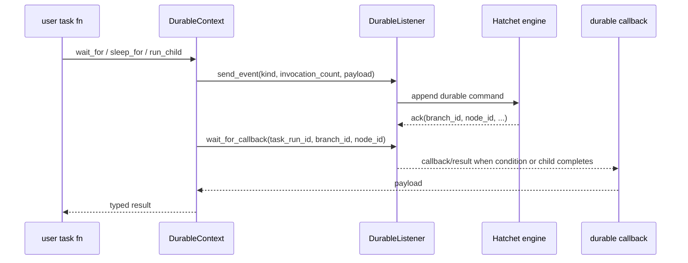

# Rust Parity Design for the Hatchet TypeScript SDK

## Executive summary

A Rust SDK with **real parity** to the current Hatchet TypeScript SDK is feasible, and the fact that the TypeScript source is public makes the job materially easier. The public source removes most ambiguity around the client surface, overloads, naming, transport split, batching behavior, and durable-runtime control flow. But it does **not** reduce the work to a simple “convert TS to Rust” exercise, because the hard part is not syntax translation; it is reproducing the SDK’s semantics around workflow declarations, run references, worker/runtime behavior, cancellation propagation, durable waits/sleeps, replay-safe child runs, and event-log-backed durable callbacks. Those semantics are visible in the TS source and docs, but they still need an idiomatic Rust implementation. citeturn10search0turn10search1turn10search2turn19view0turn24view3turn25view2

My best estimate is that **meaningful parity** with the public TS v1 surface is roughly **22–30 person-weeks** for one strong Rust engineer, or about **10–16 weeks for a two-person team**, assuming the Hatchet engine interfaces are stable and protobuf/openapi generation is straightforward. If the goal is a narrower MVP that intentionally excludes internal-only middleware typing, legacy-v0 compatibility, CEL/filter/webhook extras, and full durable-replay conformance polish, the effort drops to roughly **13–17 person-weeks**. The long pole is the durable runtime, not the REST client wrappers. That inference follows directly from the depth of `DurableContext`, child-run orchestration, durable listener usage, wait/sleep semantics, and worker/runtime code in the TS source. citeturn19view0turn23view5turn24view3turn25view2turn30view4turn30view6

The existing unofficial Rust crate is useful as a **gap reference**, not as a parity baseline. It already covers the basics of tasks, workflows, workers, `run`/`run_no_wait`, cron, schedule, `Context.log`, `Context.parent_output`, `Context.put_stream`, and stream subscription. But its published API and source tree do **not** expose durable-task APIs, durable context, child-run spawning, timeout refresh, direct event emission, logs/metrics/workers/workflows management clients, or the broader TS management surface. In other words, it demonstrates that Hatchet feels natural in Rust for the simple path, while also showing how much parity work remains. citeturn32view0turn35view0turn37search1turn37search2turn42view0

## Research basis and assumptions

This report is based primarily on the official Hatchet docs, the public TypeScript source on entity["company","GitHub","developer platform"], and the published unofficial Rust crate docs on entity["organization","docs.rs","rust documentation host"]. I treated the TS v1 source under `sdks/typescript/src/v1` as the authoritative implementation spec, and the official reference docs as the public-facing contract. I used the unofficial Rust crate only to measure current coverage and to see where Rust ergonomics already exist. citeturn10search0turn10search1turn10search2turn39view0turn32view0

Two assumptions matter. First, I assume parity should target the **current TS v1 surface**, not the legacy v0 compatibility layer. The TS client still carries some legacy bridging, but its primary API is clearly the v1 client/declaration/context surface. Second, I treat anything clearly marked `@internal` or `@hidden` as lower-priority for parity unless it materially affects user ergonomics. A good example is typed middleware: the public SDK matrix says TypeScript middleware support is not a supported capability, while the current source still contains `HatchetClient.init(...).withMiddleware(...)` as an internal, type-retyping helper. That makes middleware a “nice to have” compatibility item, not a day-one parity blocker. citeturn0search4turn19view0

The biggest practical consequence of having open TS source is that it makes the SDK far easier to **spec from source**. You can read exact overloads, see how child-run indices are propagated, observe which features use REST versus gRPC, and identify replay-sensitive behavior that the public docs alone do not spell out. An LLM can help generate large amounts of Rust wrapper code from that source, but only if it is guided by a deliberately designed Rust architecture and conformance tests. citeturn19view0turn23view0turn24view3turn31view5

## TypeScript feature inventory and Rust mapping

The table below condenses the features you explicitly asked about. In the “TS API / refs” column, I include exact symbol names and source line references from the current TS source where possible. The rest of each row sketches an idiomatic Rust design, mapping strategy, complexity/risk, test focus, runtime primitives, and rough engineering effort.

| Feature | TS API / refs | Proposed Rust API and mapping | Complexity, testing, primitives, effort |
|---|---|---|---|
| **Client surface** | `HatchetClient.init<T,U>(config?, options?, axiosConfig?)`, `withMiddleware<M>(middleware)`, `workflow(options)`, `task(options)`, `durableTask(options)`, `runNoWait(workflow,input,options)`, `runAndWait(...)`, `run(...)`, lazy getters for `crons`, `scheduled`/`schedules`, `events`, `metrics`, `filters`, `tenant`, `webhooks`, `logs`, `ratelimits`, `runs`, `workflows`, `workers`, plus `worker(name, options?)`. Source refs: `client.ts:214-242, 281-376, 388-430, 447-727`. citeturn19view0turn10search0 | Use a cheap-to-clone `HatchetClient` over `Arc<Inner>`, with explicit `rest` and `grpc` subclients. Preserve the names that matter ergonomically: `workflow`, `task`, `durable_task`, `run`, `run_no_wait`, `runs()`, `crons()`, `schedules()`, `events()`, `workers()`, etc. Rust should avoid TS’s type-reparameterizing “mutating builder” trick; instead, use typed builders and generic task/workflow declarations. Mapping: **re-implement idiomatically** over generated REST and gRPC clients. | **Medium.** The surface itself is straightforward, but it becomes the dependency root for everything else. Test clone semantics, config loading, transport reuse, and feature-client laziness. Runtime primitives: `Arc`, `reqwest` or generated OpenAPI client, `tonic`, `tokio`. **Effort: 1.5–2.5 pw.** |
| **Auth, config, env** | Constructor loads config with `ConfigLoader.loadClientConfig(...)` and validates with `ClientConfigSchema.parse(...)`; official docs enumerate env-based auth and transport knobs including `HATCHET_CLIENT_TOKEN`, TLS strategy, and host/port settings. Source refs: `client.ts:126-184`; docs SDK matrix and env section. citeturn0search4turn19view0 | `HatchetClient::from_env()`, `HatchetClient::from_config(Config)`, and maybe `HatchetClient::builder()`. Keep transport config explicit: API URL, gRPC address, token, TLS mode, namespace, logger/tracing config. Prefer strongly typed config structs plus `serde`/`envy` or manual env parsing. Mapping: **direct port with Rust-native config types**. | **Low to medium.** Behavior is familiar; biggest risk is mismatching Hatchet’s exact env variable names and transport defaults. Test table-driven env parsing and invalid-config failures. Runtime primitives: TLS config, channel setup, token interceptors. **Effort: 1–1.5 pw.** |
| **Task/workflow declarations and builder ergonomics** | `WorkflowDeclaration.task(...)`, `onFailure(...)`, `onSuccess(...)`, `durableTask(...)`; `TaskWorkflowDeclaration` inherits workflow execution helpers; task options support retries, backoff, rate limits, worker labels, concurrency, `waitFor`, `cancelIf`, `skipIf`, and durable `evictionPolicy`. Source refs: `declaration.ts:857-1009, 1038-1225`; `task.ts:54-248`. citeturn10search1turn30view2turn30view1 | Rust should **not** attempt to reproduce TS type-level inference literally. The idiomatic design is a typed builder DSL, optionally complemented later by proc macros. Suggested core types: `Workflow<I, O>`, `Task<I, O>`, `DurableTask<I, O>`, `TaskOptions`, `DurableTaskOptions`, and `Runnable<I, O>`. Preserve capability parity, not TS’s exact generic gymnastics. For DAG ergonomics, use builder chaining such as `.task(...)`, `.durable_task(...)`, `.on_failure(...)`, `.on_success(...)`, `.depends_on(...)`. Mapping: **re-implement idiomatically**. | **Medium to high.** Regular declarations are manageable; “ergonomic parity” is harder because Rust’s type system pushes you toward builders, traits, macros, and `Serialize`/`DeserializeOwned` bounds instead of overloads. Test compile-time examples, dependency graph creation, option serialization, and deterministic DAG ordering. Runtime primitives: `serde`, phantom types, trait objects only where unavoidable. **Effort: 3–4.5 pw.** |
| **`run`, `runNoWait`, bulk runs** | `BaseWorkflowDeclaration.runNoWait(input | input[])`, `run(input | input[])`, `runAndWait(...)`, plus `runManyNoWait(runs)`, `runMany(runs)`. Array runs preserve order and optionally return exceptions; when called inside a durable parent they route to durable child spawning. Source refs: `declaration.ts:357-528, 539-639`; `TaskWorkflowDeclaration` forwards standalone-task runs to the same machinery at `declaration.ts:1064-1171`. citeturn10search1turn30view1 | Preserve the names in snake_case: `run`, `run_no_wait`, `run_many`, `run_many_no_wait`. Return a typed `WorkflowRunRef<O>` for no-wait calls. Prefer explicit APIs over array-overloaded behavior, because Rust overloading does not exist; e.g. support both `run(&input, opts)` and `run_many(&[RunRequest<I>])`. Mapping: **re-implement idiomatically**, not literal overload porting. | **Medium.** Core transport path is simple, but preserving ordering, child-index propagation, cancellation inheritance, and “return exceptions” semantics requires care. Test single run, no-wait run, ordered batch results, partial failures, and child-index monotonicity. Runtime primitives: typed run refs, cancellation token, futures combinators. **Effort: 1.5–2.5 pw.** |
| **Regular runtime context** | `Context<T,K={}>` exposes `parentOutput`, `errors`, `triggers`, `filterPayload`, `triggeredByEvent`, metadata accessors, `cancel`, structured `logger`, `releaseSlot`, `bulkRunNoWaitChildren`, `bulkRunChildren`, `runChild`, `runNoWaitChild`, `additionalMetadata`, `childIndex`, `childKey`, `parentWorkflowRunId`, etc. Source refs: `context.ts:113-465, 533-644`. citeturn10search2turn23view0turn23view2turn23view3turn25view2turn26view2 | In Rust: `Context<I>` should be a cheap, cloneable handle over immutable run metadata plus shared clients and cancellation state. Use `CancellationToken` rather than exposing mutable abort controllers. Suggested methods: `parent_output<T: DeserializeOwned>(&self, name)`, `errors()`, `filter_payload<T>()`, `cancel()`, `log_*()`, `run_child`, `run_child_no_wait`, `run_children`, `metadata()`. Mapping: **re-implement idiomatically**. | **Medium.** The API is not hard; the risk is avoiding borrow-heavy context types that fight async lifetimes. Use owned handles and deserialize on demand. Test context decoding, cancel propagation, metadata parsing, task-parent output correctness. Runtime primitives: `Arc`, `CancellationToken`, `serde_json::Value`. **Effort: 1.5–2 pw.** |
| **Durable vs regular runtime contexts** | `DurableContext<T,K={}> extends Context<T,K>` and adds `supportsEviction`, `invocationCount`, eviction-aware waits, memoized `now()`, durable sleeps and event waits, and durable child-run orchestration. Source refs: `context.ts:844-924, 936-1064, 1115-1249`. citeturn23view5turn24view3turn24view4turn27view0 | Rust should represent this as a distinct `DurableContext<I>` rather than trying to make one context type conditionally durable. The handler signature should be different as well: `Fn(I, DurableContext<I>) -> impl Future<Output = Result<O, HatchetError>>`. Keep replay-sensitive operations only on `DurableContext`. Mapping: **re-implement semantics**, not syntax. | **High.** This is the hardest part of parity because the durable context is a semantic contract with the engine, not a convenience wrapper. Testing must include replay determinism, durable callback correlation, branch/node identity, eviction/no-eviction compatibility, and engine-version behavior. Runtime primitives: durable listener gRPC client, persistent callback waits, memo storage keys, cancellation signaling. **Effort: 5–7 pw.** |
| **Child runs** | Regular context: `runChild`, `runNoWaitChild`, `bulkRunChildren`, `bulkRunNoWaitChildren`. Durable context: `spawnChild`, `spawnChildren`, implemented through durable listener events and callback waits. Source refs: `context.ts:506-603, 1115-1196`; top-level workflow `run(...)` also rewrites to durable child runs when a durable parent context exists at `declaration.ts:569-577, 611-619`. citeturn25view2turn26view2turn26view5turn24view3 | Rust should offer **both** regular child-run helpers and durable child-run helpers, but with a single end-user naming story. I would expose `run_child`, `run_child_no_wait`, `run_children`, `run_children_no_wait` on `Context`, and the same methods on `DurableContext`, with durable implementations going through the durable listener. Ownership should favor owned `RunRequest<I>` structs over borrowed slices when needing persistence. Mapping: **mixed** — direct naming parity, idiomatic Rust request structs. | **High in durable mode, medium otherwise.** Replay safety is the risk: child indices, sticky assignment, metadata propagation, and callback matching must remain deterministic across replays. Test exact result ordering, stable child indices, parent cancellation, sticky worker correctness, and restart/replay scenarios. Runtime primitives: durable callback ledger, streaming callback wait, bounded task fan-out. **Effort: 2–3 pw** on top of durable core. |
| **Streaming and timeout refresh** | `ctx.putStream(data: string | Uint8Array)`, `ctx.refreshTimeout(incrementBy: Duration)`, `ctx.releaseSlot()`, `runs.subscribeToStream(workflowRunId): AsyncIterableIterator<string>`, and event-side `putStream(...)` / `putLog(...)`. Source refs: `context.ts:426-465`; `runs.ts:252-270`; `event-client.ts:134-190`. citeturn23view2turn24view5turn30view4turn31view5 | Rust should expose `put_stream<B: Into<Bytes>>`, `refresh_timeout(DurationLike)`, and `release_slot()`. For consumers, prefer `impl Stream<Item = Result<Bytes, HatchetError>>` or `BoxStream<'static, Result<Bytes, HatchetError>>`, with optional `into_utf8_lines()` helpers. Mapping: `refresh_timeout` and `release_slot` are **direct ports**; streaming should be **idiomatic Rust streams**. | **Medium.** The code is simple, but streaming needs backpressure and cancellation semantics that feel natural in Rust. Test chunk ordering, mixed binary/string payloads, cancellation during active stream, and time-extension edge cases. Runtime primitives: `bytes::Bytes`, `tokio::sync::mpsc` or direct tonic stream adaptation, cancellation tokens. **Effort: 1.5–2 pw.** |
| **Durable sleep / `waitFor` / `waitForEvent` / replay-safe clock** | `sleepFor(duration, readableDataKey?)`, `waitFor(conditions)`, overloaded `waitForEvent(key, expression?, payloadSchema?, scope?, lookbackWindow?)`, `sleepUntil(wakeAt)`, and replay-safe `now()` built on durable memoization. Source refs: `context.ts:902-1064`. citeturn24view0turn24view3turn27view0 | Provide `DurableContext::sleep_for`, `sleep_until`, `wait_for`, `wait_for_event`, and `now`. Do **not** implement these as local timers. They must be engine-mediated durable waits. For typing, use `serde::DeserializeOwned` or optional schema validators rather than a direct Zod analogue; payload schemas can be a later optional layer. Mapping: **semantic re-implementation** over durable listener APIs. | **High.** This is the replay-safety core. Test restart persistence, lookback windows, event filtering, payload decoding failures, zero-match behavior, and clock determinism. Runtime primitives: persistent event-log access, durable callback waits, stable JSON serialization for memo keys, maybe SHA-256 memo keys to mirror TS behavior. **Effort: 4–6 pw.** |
| **Scheduling, cron, delay** | `BaseWorkflowDeclaration.schedule(enqueueAt,input,options)`, `delay(duration,input,options)`, `cron(name,expression,input,options)`; task declarations inherit these helpers. `CronClient.create/delete/list/get`; `ScheduleClient.create/update/delete/list/get/bulkDelete/bulkUpdate`. Source refs: `declaration.ts:650-717, 1181-1218`; `crons.ts:15-139`; `schedules.ts:20-224`. citeturn10search1turn30view5turn30view6 | Keep the end-user verbs but Rustify the naming slightly: `schedule_at`, `delay_for`, `cron`, plus `crons().create(...)`, `schedules().create(...)`, etc. Use typed `CronSpec`, `ScheduleAt`, and `RunOptions` structs. Mapping: mostly **direct port** over REST clients, with more explicit option structs. | **Low to medium.** Transport work is straightforward; biggest risk is API naming and date/time handling. Test RFC3339 serialization, bulk reschedules/deletes, namespace application, and priority/metadata propagation. Runtime primitives: `chrono` or `time`, REST client codegen, serde. **Effort: 1.5–2 pw.** |
| **Events** | `EventClient.push(type,input,options?)`, `bulkPush(type,inputs,options?)`, `putLog(taskRunExternalId,...)`, `putStream(taskRunExternalId,...)`, `list(opts?)`, with source metadata injection when called from child context. Source refs: `event-client.ts:23-190`. citeturn31view5 | Rust should expose an `EventsClient` with `push`, `bulk_push`, `list`, and internal helpers for runtime logging/streaming. Use typed `PushEventOptions` and an `EventEnvelope<T>`. Preserve automatic parent-source metadata injection when an event is emitted from inside a running task. Mapping: **direct gRPC/REST wrapper**, but Rustify types. | **Medium.** The API itself is modest; the subtlety is preserving metadata injection and retry behavior. Test event-key namespacing, metadata propagation, scope/priority, bulk ordering, and runtime-emitted events from child runs. Runtime primitives: tonic client, retry/interceptor middleware. **Effort: 1.5–2.5 pw.** |
| **Workers** | `client.worker(name, options?) -> Promise<Worker>` and worker runtime with registration, durable-action registration, `start`, `stop`, `upsertLabels`, pause/unpause, and `waitUntilReady`. Source refs: `client.ts:723-727`; `worker.ts:21-26, 67-83, 93-101, 120-139, 188-246`. citeturn10search0turn30view3 | The Rust SDK should have a real worker runtime, not just a client wrapper: `WorkerBuilder`, `Worker`, `Register`/`add_task_or_workflow`, `start`, `stop`, `wait_until_ready`, `upsert_labels`. Use owned registered definitions and a runtime registry for executable handlers. Mapping: **re-implement idiomatically**; this is runtime code, not just API glue. | **Medium to high.** The operational complexity is in lifecycle, cancellation, slot concurrency, labels, and durable-task registration. Test worker start/stop, readiness, pause/unpause, label updates, durable-task registration, and concurrent slot behavior. Runtime primitives: `tokio` tasks, bounded work queues, cancellation tokens, gRPC action listener. **Effort: 3–4.5 pw.** |
| **Logs, metrics, runs, crons, schedules, workflows, workers, rate limits clients** | `LogsClient.list(taskRunId, opts?)`; `MetricsClient.getTaskStatusMetrics`, `getQueueMetrics`, `scrapePrometheusMetrics`, `getTaskStats`; `RunsClient.get`, `get_status`, `list`, `cancel`, `replay`, `restoreTask`, `branchDurableTask`, `getTaskExternalId`, `subscribeToStream`; `WorkflowsClient.get/list/delete`; `WorkersClient.get/list/isPaused/pause/unpause`; `RatelimitsClient.upsert/list`. Source refs: `logs.ts:10-59`; `metrics.ts:4-71`; `runs.ts:10-271`; `workflows.ts:25-164`; `workers.ts:3-67`; `ratelimits.ts:16-58`. citeturn30view4turn30view7turn31view0turn31view1turn31view2turn31view3 | These are ideal Rust wrappers over generated REST/gRPC clients. Expose them as strongly typed subclients with explicit request structs. `RunsClient` should likely own `WorkflowRunRef` creation and stream subscription. `branch_durable_task` and `restore_task` should remain explicit durable-ops APIs. Mapping: mostly **direct port**. | **Low to medium.** This is the easiest parity surface once transports exist. Test request serialization, pagination/filter mapping, stream subscription, and durable-task admin ops. Runtime primitives: REST client generation, `futures::Stream`, typed filters, retry policy. **Effort: 3–4 pw total for the client family.** |

A crucial pattern in the TS runtime is that regular and durable flows are **intentionally different**. Regular context methods mostly act like direct client calls. Durable context methods go through a durable listener, persist callback state, and recover correctly across replay and eviction boundaries. That distinction should survive in Rust rather than being hidden behind one magical context type. citeturn23view5turn24view3turn27view0

## Proposed architecture and runtime model

The most idiomatic Rust design is a **hybrid SDK** with a typed declaration DSL, generated transport clients, and a deliberately narrow runtime contract for task executors. The right mental split is:

- **Transport layer**: generated REST client plus generated tonic clients for dispatcher, events, run listener, and durable listener.
- **Public SDK layer**: `HatchetClient`, subclients, declaration builders, typed run refs, worker runtime.
- **Execution layer**: `Context<I>` and `DurableContext<I>`, backed by immutable run metadata and shared transport handles.
- **Conformance layer**: a suite that executes the same workflows against the same engine and verifies TS-vs-Rust equivalence for returns, retries, waits, child runs, streaming, and replay. The source strongly suggests that this last layer is essential if parity is the goal rather than just “Rust support.” citeturn19view0turn24view3turn30view4turn31view5

I would make the public Rust API look roughly like this:

```rust
let client = HatchetClient::from_env()?;

let wf = client
    .workflow::<MyInput, MyOutput>("my-workflow")
    .task("step_a", step_a)
    .durable_task("step_b", step_b)
    .on_failure("cleanup", cleanup)
    .build()?;

let out = wf.run(&input, None).await?;
let run = wf.run_no_wait(&input, None).await?;
let status = client.runs().get_status(run.id()).await?;
```

Under the hood, declarations should be **owned, clonable handles** over serializable definitions plus function registries. Inputs and outputs should use `Serialize` and `DeserializeOwned`, with `serde_json::Value` available for escape hatches. Errors should be unified under a `HatchetError` enum using `thiserror`, with variants for transport, validation, cancellation, timeout, decode, and engine errors. Cancellation should flow through `tokio_util::sync::CancellationToken`, not by exposing mutable controllers the way TS can. That choice makes ownership and async borrowing much cleaner in Rust. This is an idiomatic re-implementation, not a transliteration. citeturn19view0turn23view0turn35view0

The durable path should be modeled explicitly as event-log-backed control flow:



That sequence is the core reason an LLM-only translation is insufficient. In TS, durable waits and child runs are not syntactic sugar over regular client calls; they are recorded durable commands correlated by run id, invocation count, branch id, and node id, with replay-aware recovery paths. Rust must preserve that contract exactly, while presenting a more natural API around `Future`, `Stream`, owned inputs, and typed decoding. citeturn24view3turn24view4turn27view0

## Gap against the unofficial Rust crate

The published unofficial crate already proves that a Rust Hatchet SDK can feel good for core use cases. But compared with the current TS SDK, it is still much closer to a **core workflow crate** than a parity-grade SDK. The gap table below compares current TS coverage with what the unofficial crate publicly exposes today.

| Feature area | TS status | Unofficial Rust crate | Status | Evidence |
|---|---|---:|---|---|
| Client object with task/workflow/worker creation | Full | `Hatchet` exposes `from_env`, `from_token`, `task`, `workflow`, `worker` | **Present** | citeturn19view0turn37search1 |
| `run` / `runNoWait` | Full | `Runnable` provides `run` and `run_no_wait` on `Task` and `Workflow` | **Present** | citeturn19view0turn34view0turn36view2 |
| Bulk runs (`runMany`, array overloads) | Full | No published `run_many`/batch API on `Task` or `Workflow` | **Missing** | citeturn30view1turn34view1turn36view3 |
| Workflow DAG declarations | Full | `Workflow::add_task`, `Task::add_parent` | **Present** | citeturn36view4turn34view1 |
| `onFailure` / `onSuccess` workflow hooks | Full | No corresponding public API documented | **Missing** | citeturn30view1turn37search1 |
| Durable task declarations | Full | No public `durable_task` or `DurableContext` surface documented | **Missing** | citeturn19view0turn35view0turn37search1 |
| Regular `Context` | Full | `Context` exposes `parent_output`, `filter_payload`, `log`, `put_stream` | **Partial** | citeturn35view0turn10search2 |
| Timeout refresh / release slot | Full | No public context methods documented | **Missing** | citeturn23view2turn35view0 |
| Child runs from context | Full | No public child-run APIs documented | **Missing** | citeturn25view2turn26view5turn35view0 |
| Durable sleep / wait / wait-for-event / replay-safe clock | Full | No public durable equivalents documented | **Missing** | citeturn24view3turn27view0turn35view0 |
| Streaming producer and consumer | Full | `Context.put_stream` and `RunsClient.subscribe_to_stream` exist | **Present** | citeturn35view0turn37search2 |
| Scheduling and cron | Full | `schedule` and `cron` exist on `Task`/`Workflow`; schedule/cron clients are exported | **Present** | citeturn36view0turn37search0 |
| Delay helper | Full | No documented `delay` helper on `Task`/`Workflow` | **Missing** | citeturn30view1turn34view1turn36view0 |
| Runs client | Full | `RunsClient.get`, `subscribe_to_stream` documented | **Partial** | citeturn37search2turn30view4 |
| Crons client | Full | `CronsClient` documented/exported | **Present** | citeturn37search0turn30view5 |
| Schedules client | Full | `SchedulesClient` documented/exported | **Present** | citeturn37search0turn30view6 |
| Events client | Full | No public events client exposed from `Hatchet` | **Missing** | citeturn31view5turn37search1 |
| Logs client | Full | No public logs client documented | **Missing** | citeturn30view7turn37search1 |
| Metrics client | Full | No public metrics client documented | **Missing** | citeturn31view0turn37search1 |
| Workflows management client | Full | No public workflows management client documented | **Missing** | citeturn31view2turn37search1 |
| Workers management client | Full | Worker runtime exists, but no public workers management client documented on `Hatchet` | **Partial** | citeturn31view1turn37search1 |
| Builder ergonomics | Full, heavily typed | Builders exist (`TaskBuilder`, `WorkflowBuilder`, `TriggerWorkflowOptionsBuilder`) but narrower than TS | **Partial** | citeturn33view0turn34view3turn19view0 |

The practical takeaway is that the unofficial crate is a useful **proof of fit** for Rust, but not a near-parity implementation. Its public surface maps well to the “simple” half of the TS SDK and almost none of the durable-runtime half. citeturn32view0turn37search1turn42view0

## Implementation backlog and recommendation

The right implementation plan is not “convert file by file.” It is **transport first, then declarations, then runtime, then durable semantics, then conformance**. That sequence minimizes rework and gives you usable milestones early. The TS source is especially valuable as a spec during the durable and worker phases, where function names alone are not enough. citeturn19view0turn24view3turn30view4

### Recommended phases

| Phase | Scope | Milestone / acceptance criteria | Estimate |
|---|---|---|---:|
| **Foundation** | Config/env, authentication, REST/gRPC generation, `HatchetClient`, subclient skeletons, error model | `HatchetClient::from_env()` works; transport smoke tests pass; `runs/crons/schedules/events` clients compile and authenticate against a live tenant | **2–3 pw** |
| **Core declarations** | `Workflow`, `Task`, `Runnable`, basic builders, `run`, `run_no_wait`, `run_many`, `WorkflowRunRef` | Users can declare tasks/workflows, run them, await results, and retrieve run status/streams | **3–4 pw** |
| **Worker runtime** | Worker builder/runtime, task registry, labels, readiness, pause/unpause, context decoding, basic logging/streaming | A Rust worker can execute declared tasks reliably in integration tests and expose `Context` features | **3–4 pw** |
| **Operational clients** | Logs, metrics, workflows, workers, rate limits, richer runs/crons/schedules operations | SDK reaches operational parity for non-durable admin workflows and dashboards | **2–3 pw** |
| **Durable runtime** | `DurableContext`, durable waits/sleeps, replay-safe `now`, durable child runs, restore/branch support | End-to-end durable workflows survive restart/replay and match TS behavior on core scenarios | **6–8 pw** |
| **Conformance and polish** | TS-vs-Rust behavior suite, docs, examples, error text cleanup, ergonomic refinements | Cross-language parity tests pass; examples cover standard and durable workflows; docs are good enough for external users | **3–5 pw** |

This sequence sums to about **19–27 person-weeks** in the happy path, but I would reserve contingency for durable-runtime edge cases and worker lifecycle issues. That is why the overall planning estimate stays closer to **22–30 person-weeks**. citeturn23view5turn24view3turn30view4turn37search2

### Recommended acceptance tests

The acceptance bar for parity should be behavior-driven, not API-name-driven:

- **Declaration parity**: equal workflow graphs, parent dependencies, `on_failure`/`on_success`, task option serialization.
- **Execution parity**: `run`, `run_no_wait`, `run_many`, ordered results, exception behavior, cancellation propagation.
- **Context parity**: parent outputs, filters, metadata, logging, streams, timeout refresh.
- **Durable parity**: `sleep_for`, `sleep_until`, `wait_for`, `wait_for_event`, `now`, child-run orchestration, replay determinism across restart.
- **Ops parity**: runs/crons/schedules CRUD, branch/restore durable tasks, logs/metrics/admin clients.
- **Backpressure parity**: stream subscription under slow consumer and cancellation conditions. citeturn24view3turn25view2turn30view4turn30view6turn31view0

### Recommendation

If the goal is “Can I point an LLM at the TS SDK and get a usable Rust SDK quickly?”, the answer is **yes for the wrapper-heavy parts and no for the semantic parts**. An LLM is very likely to accelerate:

- OpenAPI / REST wrapper generation
- Tonic wrapper scaffolding for events and listeners
- Mechanical option-struct translation
- Builder boilerplate
- Signature extraction and docs generation

An LLM is **not** enough on its own for:

- Durable replay semantics
- Correct cancellation and ownership design in async Rust
- Worker runtime lifecycle
- Stream backpressure and cancellation
- Conformance-quality parity testing
- Choosing where to keep names versus where to Rustify the API

So the public TS source absolutely makes the conversion easier, but mostly because it acts as an **implementation spec**, not because TS can be faithfully “transpiled” into good Rust. The right strategy is to use the TS source as the authoritative behavior reference while designing a Rust SDK that feels native to Rust from day one. citeturn19view0turn24view3turn31view5turn39view0

## Assumptions and caveats

This analysis assumes parity against the **current public TS v1 SDK surface** in the main Hatchet repository, not against an older package split or the legacy v0 API. It also assumes that parity means **behavioral parity** for the public APIs you named, not byte-for-byte reproduction of TS implementation details or every internal helper. I treated internal-only TS middleware typing as out of scope for MVP parity because the official SDK matrix does not present middleware as a supported TS capability even though internal source hooks exist. Finally, the unofficial Rust crate comparison is based on its **published public API** and visible source tree, which is the right baseline if the question is “what gap would a new parity-focused Rust SDK still need to close?” citeturn0search4turn19view0turn32view0turn42view0
