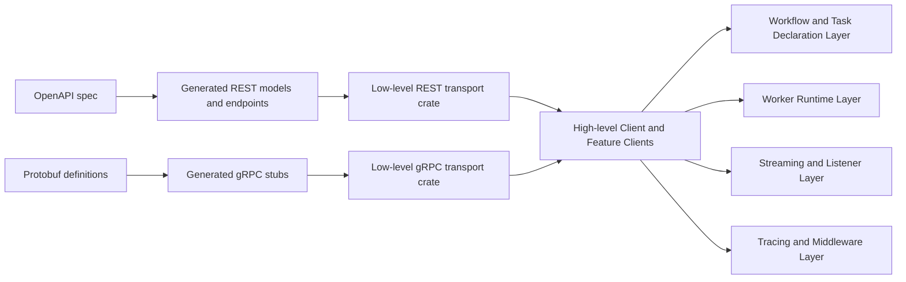
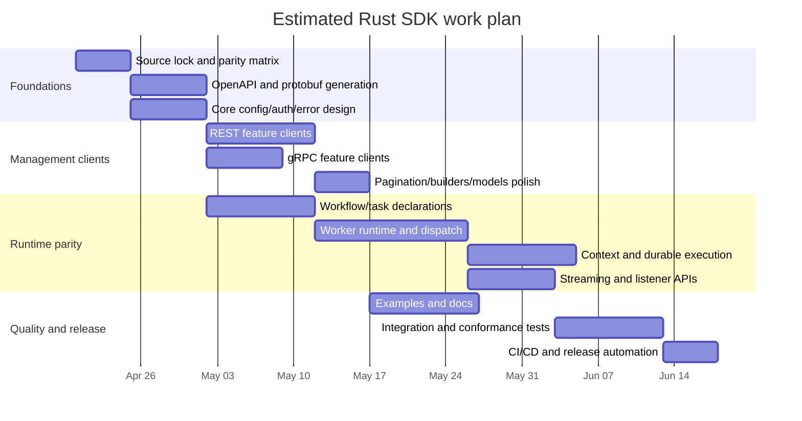

# Rust SDK parity with the official Hatchet TypeScript SDK

## Executive summary

Creating a Rust SDK that reaches practical feature parity with the current official Hatchet TypeScript SDK is **feasible**, but “parity” should be interpreted as **behavioral parity and capability parity**, not literal API-shape duplication. The TypeScript SDK is a hybrid of hand-written orchestration/runtime code and generated REST/gRPC bindings: the package scripts generate REST clients from an OpenAPI file with `swagger-typescript-api`, generate protobuf code separately, and then layer hand-written workflow/task declarations, workers, listeners, and ergonomics on top. That architecture maps well to Rust because Rust has mature equivalents for all three layers: code generation for REST/OpenAPI, code generation for protobuf/gRPC, and strong library support for async runtimes, builders, typed models, streaming, and tracing. citeturn15view0turn22view1turn22view2turn22view3turn22view4

The **easy parity** work is the admin/API surface: cron, filters, logs, metrics, rate limits, runs, schedules, webhooks, workers, workflows, tenant access, Bearer-token authentication, TLS/MTLS config, request typing, and release/versioning discipline. The **hard parity** work is the worker/runtime side: task/workflow declaration ergonomics, typed child-workflow spawning, durable execution helpers, real-time run listeners, stream consumption, and middleware/type-inference ergonomics. Those features exist in the TypeScript SDK through factory-style declarations, generic types, `Context`/`DurableContext`, gRPC listeners, and `AsyncIterable`/`AsyncGenerator` streaming; they are all implementable in Rust, but some require adaptation into idiomatic Rust patterns rather than a 1:1 port. citeturn44view0turn14view0turn12view1turn11view0turn29view0turn29view2turn29view3

The largest technical reason parity is viable is that the TypeScript SDK does **not** appear to rely on browser-native real-time primitives such as WebSockets at the SDK layer. Instead, the current SDK’s real-time path is centered on gRPC listeners (`nice-grpc`, optional `@grpc/grpc-js`) and Node-oriented runtime facilities such as `https`, `EventEmitter`, `process.version`, and `process.platform`. That makes a Rust parity target on native/server targets straightforward with `tokio`, `tonic`, `prost`, `serde`, and `reqwest`, while simultaneously making exact browser/WASM parity for worker/listener features a **separate, optional scope** rather than a day-one requirement. The user’s WASM requirement is unspecified; the sources support treating it as optional and scoped to a reduced REST-only subset unless Hatchet later publishes an official browser transport. citeturn24view1turn26view2turn29view0turn35view2turn31view0

A realistic effort range is:

| Scope | Estimated effort |
|---|---:|
| Minimal viable parity | **8–12 person-weeks** |
| Full parity including docs/examples/testing | **18–28 person-weeks** |
| Ongoing maintenance | **1–2 person-weeks per quarter** for routine drift, **3–5 person-weeks per quarter** if upstream continues changing as quickly as the March–April 2026 changelog suggests |

Those ranges assume experienced Rust engineers, no budget constraints, and a decision to target **Rust 2021** on native/server platforms first.

## Source basis and what the TypeScript SDK currently is

The official TypeScript package is currently published as `@hatchet-dev/typescript-sdk` at version **1.21.0**. Its package metadata shows unit and e2e test scripts, docs generation, stable and alpha publish scripts, OpenAPI-driven REST generation, protobuf generation, and dependencies centered on `axios`, `nice-grpc`, protobuf tooling, and `zod`. The changelog explicitly says the SDK follows **Semantic Versioning** and, as of April 2026, shows an actively changing surface with recent additions such as `runMany` / `runManyNoWait`, metrics methods, logs, durable-event helpers, and OpenTelemetry instrumentation. citeturn15view0turn16view0

The official docs describe Hatchet as a workflow/task platform with generated, tested cross-language examples. The TypeScript reference documents a `HatchetClient`, `Runnables`, `Context`, and feature clients for crons, filters, logs, metrics, rate limits, runs, schedules, webhooks, workers, and workflows. The repository tree also shows hand-written packages for REST wrappers, dispatcher/gRPC clients, listeners, worker code, and a large `src/v1/examples` tree covering concurrency, cancellation, child workflows, durable execution, events, logging, middleware, retries, scheduling, streaming, timeouts, webhooks, and OpenTelemetry. citeturn18search8turn44view0turn14view0turn12view1turn22view2turn22view3turn22view4turn23view0turn23view2turn23view3

One important research finding is that the first-party sources are **not perfectly synchronized**. The contributing SDK matrix still marks TypeScript middleware and scheduled workflows as unsupported, yet the current TypeScript reference and examples clearly expose middleware-related generics, workflow/task scheduling, `scheduled` / `schedules` accessors, and schedule-management clients. Likewise, the April 2026 changelog and bulk-run guide document `runMany` / `runManyNoWait`, while the `Runnables` reference page still lists the older method set. Any Rust parity plan therefore needs to treat the repository + changelog + guides as the source of truth, and the compatibility matrix/reference pages as possibly lagging. citeturn45view0turn44view0turn40search0turn16view0turn37search0turn14view0

The primary sources used for this report were the official repository metadata and docs pages linked throughout this report. Those sources were sufficient to determine the TypeScript surface; the unofficial Rust SDK was not necessary to resolve the TypeScript feature inventory.

## Feature inventory and parity classification

### Top-level client, runnables, and runtime surfaces

The top-level `HatchetClient` surface is broad but structurally simple: it is an async-first entry point with accessors for the various feature clients plus methods to declare tasks/workflows, create workers, and trigger runs. From a Rust perspective, nearly all of that is implementable directly; the main adaptation is ergonomic, because TypeScript leans on overloaded functions and structural typing whereas Rust generally prefers explicit method names, builder objects, and trait-based conversions. citeturn44view0turn14view0turn12view1

| TypeScript surface | Evidence from official sources | Rust parity | Why |
|---|---|---|---|
| `HatchetClient` accessors: `api`, `events`, `crons`, `filters`, `logs`, `metrics`, `ratelimits`, `runs`, `scheduled` / `schedules`, `tasks`, `tenant`, `webhooks`, `workers`, `workflows` | Documented in the client reference. `tasks` returns `WorkflowsClient`; `scheduled` and `schedules` are aliases. citeturn44view0 | **Direct** | Natural mapping to sub-clients on a Rust `Client` struct. |
| `workflow()`, `task()`, `durableTask()` factories | Documented in client reference and `Runnables`; V1 migration docs call out the factory pattern and typed declarations as a major design change. citeturn44view0turn14view0turn32view1 | **Adaptation** | Rust can offer factory/builders and macros, but cannot reproduce TS inference patterns exactly without proc-macros and some explicit type annotations. |
| `run()`, `runAndWait()`, `runNoWait()` | Documented on `HatchetClient` and `TaskWorkflowDeclaration`. `runAndWait` is effectively an alias of `run`. citeturn44view0turn14view0 | **Direct** | Straightforward async methods returning `Result<T, Error>` or a `WorkflowRunRef`. |
| `runMany()` / `runManyNoWait()` | Added in `1.21.0` changelog and described in the bulk-run guide, but not yet listed on `Runnables` reference pages. citeturn16view0turn37search0turn14view0 | **Direct** | Natural Rust methods over `Vec<RunManyItem<T>>`; this is simpler in Rust than TS overloads. |
| `WorkflowDeclaration.task()`, `durableTask()`, `onFailure()`, `onSuccess()` | Documented in `Runnables`. citeturn14view0 | **Adaptation** | Feasible, but the most idiomatic Rust API will likely use explicit handles/builders instead of TS’s object mutation plus generic inference. |
| `TaskWorkflowDeclaration.cron()`, `delay()`, `run()`, `runNoWait()`, `schedule()` | Documented in `Runnables`. citeturn14view0 | **Direct** | These are just trigger helpers over API calls. |
| `WorkflowRunRef` typed run references | Exposed in return types for `runNoWait()` and child-run helpers. citeturn44view0turn14view0turn13search4 | **Direct** | Maps cleanly to a lightweight owned Rust handle carrying run ID plus sub-client references. |
| `Context`, `ContextWorker`, `DurableContext` with child-run, timeout, stream, metadata, durable wait/sleep helpers | Substantial runtime surface documented in the `Context` reference, including `putStream`, `refreshTimeout`, `releaseSlot`, `runChild`, `bulkRunChildren`, `waitFor`, `waitForEvent`, `sleepFor`, `sleepUntil`, and worker label operations. citeturn12view1turn13search4turn40search6 | **Adaptation** | Fully feasible, but Rust will want borrowed contexts, owned handles for child refs, and explicit lifetimes or cloning instead of TS’s implicitly mutable closure/runtime model. |
| Middleware typing (`withMiddleware`, `GlobalInput`, `GlobalOutput`, before/after inference) | Visible in current client source and reflected in `HatchetClient` generics, even though the contributing matrix still marks middleware as unsupported for TypeScript. citeturn25view0turn44view0turn45view0 | **Adaptation** | Rust can do this with trait-based middleware plus generics or proc-macros, but TS-style structural merging of before/after fields is not a literal 1:1 fit. |
| Worker creation and worker runtime | `worker()` is exposed in client reference; docs show worker configuration via token, TLS, name, slots, durable slots, labels, and examples. citeturn44view0turn31view0turn33search8turn34view5 | **Adaptation** | Native Rust worker runtime is feasible, but it is the heaviest part of the parity effort because it combines dispatch, listener loops, cancellation, timeouts, tracing, retry behavior, and durable execution. |

### Feature clients and operation-level parity

The feature-client surface is mostly CRUD and query operations over REST or gRPC. This is where Rust parity is easiest.

| Feature client | Official methods | Transport evidence | Rust parity | Notes |
|---|---|---|---|---|
| Crons | `create`, `delete`, `get`, `list` citeturn10view3turn40search7 | REST-style wrapper docs and generated REST client architecture. citeturn15view0turn22view1turn24view1 | **Direct** | Best as typed request/response models plus a list paginator wrapper. |
| Filters | `create`, `delete`, `get`, `list`, `update` citeturn10view0turn36search8 | REST-style `V1*` request/response types. citeturn10view0turn15view0 | **Direct** | Straight CRUD. |
| Logs | `list` with `ListLogsOpts` including attempt, levels, limit, order, search, since, until citeturn9view2turn40search2 | REST layer. citeturn22view1turn24view1 | **Direct** | Ergonomically stronger in Rust with a builder for filters. |
| Metrics | `getQueueMetrics`, `getTaskStats`, `getTaskStatusMetrics`, `scrapePrometheusMetrics` citeturn38view0turn39search5 | REST endpoints plus Prometheus text output. citeturn18search2turn18search4 | **Direct** | `scrapePrometheusMetrics` can simply return `String` or bytes. |
| Rate limits | `list`, `upsert` citeturn39search2 | The docs call this a wrapper over Hatchet’s gRPC API. citeturn39search2turn26view2 | **Direct** | Ideal for `tonic` + strongly typed enums. |
| Runs | `branchDurableTask`, `cancel`, `get`, `get_status`, `getTaskExternalId`, `list`, `replay`, `restoreTask`, `subscribeToStream` citeturn11view0turn39search1 | Hybrid: REST-y return types on some methods, plus gRPC-backed streaming infrastructure in listeners. citeturn11view0turn29view0turn29view2turn29view3 | **Adaptation** | Unary methods are direct. `subscribeToStream` should be a Rust `Stream<Item = Result<…>>`, not a literal `AsyncIterableIterator<String>`. |
| Schedules | `bulkDelete`, `bulkUpdate`, `create`, `delete`, `get`, `list`, `update` citeturn36search5turn40search0 | REST-style scheduled-run resources. citeturn36search5turn15view0 | **Direct** | Bulk ops are particularly well-suited to Rust serde models. |
| Webhooks | `create`, `delete`, `get`, `list`, `update` citeturn10view1 | REST-style management client; webhook guide documents inbound auth modes. citeturn10view1turn18search6 | **Direct** | Important to separate webhook *management* from inbound webhook *verification* semantics. |
| Workers | `get`, `isPaused`, `list`, `pause`, `unpause` citeturn10view2turn39search3 | Admin/management client surface. citeturn10view2 | **Direct** | No major Rust-specific obstacles. |
| Workflows | `delete`, `get`, `getWorkflowIdFromName`, `list` citeturn10view4turn39search4 | Admin/management surface. citeturn10view4 | **Direct** | Rust can improve identifier conversion with `Into<WorkflowSelector>`. |
| Events | `events` accessor is documented, and platform docs + OTel docs show push and bulk-push operations conceptually, but the accessible TS reference pages reviewed here do not enumerate EventClient methods in the same way as the other feature clients. citeturn44view0turn35view2turn34view4 | Platform/event surface exists; exact TS public method inventory is underdocumented in the accessible reference. citeturn44view0turn34view4turn35view2 | **Adaptation** | A Rust SDK should include an events client, but the exact surface should be checked against repo source before implementation freeze. |
| Tenant | `tenant` accessor is documented; worker/client source also uses tenant version checking during client startup. citeturn44view0turn25view0 | Management/support surface. | **Direct** | Likely a very small client. |

### Types, models, and transport-generated surfaces

The TypeScript SDK exposes three different kinds of “types,” and a Rust SDK should mirror that separation instead of flattening everything into one crate.

| Type family | Examples visible in official sources | Recommendation for Rust |
|---|---|---|
| Hand-written domain/runtime types | `HatchetClient`, `TaskWorkflowDeclaration`, `WorkflowDeclaration`, `WorkflowRunRef`, `Context`, `DurableContext`, `Worker`, `RunOpts`, `CreateWorkflowOpts`, `CreateTaskWorkflowOpts`, `CreateDurableTaskWorkflowOpts`, `ChildRunOpts`, `Duration` citeturn44view0turn14view0turn12view1 | Hand-write these in Rust. They define the SDK’s public ergonomics. |
| OpenAPI/REST models | `V1Filter`, `V1FilterList`, `V1Webhook`, `V1WebhookList`, `V1WorkflowRunDetails`, `V1TaskSummaryList`, `V1TaskStatus`, `V1LogLineList`, `TaskStatusMetrics`, `TenantStepRunQueueMetrics`, `WorkflowList`, `WorkerList`, `ScheduledWorkflows*`, `CronWorkflows*` and many other `V1*` request/response types appearing in method signatures citeturn10view0turn10view1turn11view0turn38view0turn40search0turn40search2 | Generate from OpenAPI and re-export. Do **not** hand-maintain these one by one. |
| Protobuf/gRPC models | `DispatcherDefinition`, `StepActionEvent`, `WorkflowEvent`, `RuntimeInfo`, `DesiredWorkerLabels`, rate-limit enums and other protobuf-backed types visible in dispatcher/listener/admin code paths citeturn26view2turn29view0turn43view2 | Generate from protobuf with `prost` / `tonic-build`. |

## What Rust can match directly and what must be adapted

The TypeScript SDK’s implementation strategy is already close to the way a well-designed Rust SDK would be organized: generated transport bindings plus a hand-written high-level layer. The difference is that TypeScript’s public ergonomics come from **structural typing, overloads, and generic inference**, whereas Rust’s strengths are **explicit ownership, trait-based conversions, enums, builders, and procedural macros**. The result is that the same capabilities are available in Rust, but some surfaces should be redesigned rather than mimicked. citeturn15view0turn14view0turn44view0turn12view1

The highest-confidence direct matches are the REST and unary gRPC clients. The package generates its REST layer from OpenAPI, and the docs expose mostly typed request/response CRUD/query methods with limit/offset options. Rust ecosystems are mature here: `reqwest` or `hyper` for transport, `serde` for model serialization, and either OpenAPI codegen or a small custom generator for models and endpoints. The same is true for gRPC with `tonic` and `prost`. This means the “platform-management” half of the SDK is low risk. citeturn15view0turn22view1turn24view1turn26view2

The most significant adaptation area is the declaration/runtime API. TypeScript’s V1 design is intentionally ergonomic: `hatchet.task(...)` and `hatchet.workflow(...)` return reusable objects; child workflows can be launched from contexts with inferred input/output types; middleware fields merge into task input/output types; and the docs explicitly frame this factory pattern as a core V1 improvement. Rust can achieve the same *capabilities*, but exact parity would either produce an unidiomatic API or require heavy macro magic. The recommended approach is to preserve the semantic model while changing the surface to use builders and proc-macros where useful. citeturn32view1turn32view0turn14view0turn44view0

The streaming and real-time surfaces are also a clear adaptation case. In TypeScript, the documented public surface is `subscribeToStream(): AsyncIterableIterator<string>`, and the implementation uses listener clients based on `nice-grpc`, `EventEmitter`, retry loops, and `AsyncGenerator`s over run events. In Rust, the natural public type is not an iterator of strings but `impl Stream<Item = Result<RunEvent, HatchetError>>`, possibly with a higher-level helper that decodes string/binary task-stream payloads. That is not a feature gap; it is a feature translation. citeturn11view0turn29view0turn29view2turn29view3turn43view5

Browser/WASM support is where parity becomes partially infeasible. The current TypeScript SDK is visibly Node-oriented: the REST wrapper uses Node `https`, the dispatcher code reports `process.version` and `process.platform`, the listener path uses `EventEmitter`, and the package metadata has no browser-specific export or browser field in the package manifest. For that reason, an exact “browser/Node parity” objective should be rejected for the worker/listener side of a Rust SDK. A reduced WASM/browser admin client could exist, but a browser worker runtime or browser gRPC listener should be treated as a different product scope unless Hatchet publishes a first-party browser transport. citeturn24view1turn26view2turn29view0turn30view0turn30view3

### TypeScript constructs to Rust equivalents

| TypeScript construct | What it does in the official SDK | Recommended Rust equivalent |
|---|---|---|
| `Promise<T>` | Async-first method return type throughout client and feature clients citeturn44view0turn10view0turn11view0 | `async fn -> Result<T, HatchetError>` using `tokio` |
| `AsyncIterableIterator<T>` / `AsyncGenerator<T>` | Run-event and stream consumption citeturn11view0turn29view2turn29view3 | `futures_core::Stream<Item = Result<T, HatchetError>>` |
| Overloads (`run` single vs array; `runNoWait` single vs array) | Ergonomic bulk execution by overloading inputs citeturn14view0turn37search0 | Separate methods: `run`, `run_many`, `run_no_wait`, `run_many_no_wait` |
| Structural object options | Ad hoc option bags for list/filter/create methods citeturn10view0turn10view1turn38view0turn40search0 | Typed request structs + `derive_builder` or handwritten builders |
| Generic type inference on task/workflow declarations | Strong TS ergonomics for task input/output inference citeturn14view0turn44view0turn32view1 | Explicit generics plus optional proc-macros (`hatchet_task!`, `hatchet_workflow!`) |
| `zod` and `zod-to-json-schema` | Validation/schema production and typed config support in TS package deps and workflow creation docs citeturn15view0turn14view0 | `serde`, `schemars`, optional `validator`; possibly a macro to derive JSON schema |
| `swagger-typescript-api` generated REST client | Code-generated REST bindings from OpenAPI citeturn15view0 | `openapi-generator`, `oapi-codegen`-style custom generation, or custom Rust codegen over OpenAPI |
| `ts-proto` / `grpc-tools` / `nice-grpc` | Generated protobuf types and gRPC clients/listeners citeturn15view0turn26view2turn29view0 | `prost`, `tonic`, `tonic-build` |
| Node `https` / `@grpc/grpc-js` / `EventEmitter` | Node-oriented runtime transport and listener machinery citeturn24view1turn15view0turn29view0 | Native transports only for initial Rust parity; optional WASM split crate for REST-only functionality |
| Typed error classes and mappers | `HatchetError`, `toHatchetError`, config validation errors, retry-wrapped calls citeturn25view0turn43view3turn43view5turn43view6 | `thiserror` + `miette`/`eyre` integration, with structured variants for REST, gRPC, auth, validation, timeout, retry exhaustion |

The recommended architecture for a Rust SDK is correspondingly hybrid:



That architecture follows the spirit of the current TypeScript SDK, which separates generated REST artifacts from hand-written dispatcher/listener/runtime code. citeturn22view1turn22view2turn22view3turn22view4turn15view0

## Recommended Rust SDK design

The most idiomatic Rust SDK would be **async-first** and would not initially ship a synchronous twin API. Hatchet is fundamentally networked and event-driven, and the TypeScript SDK is entirely promise-based. A blocking facade could be added later through `reqwest::blocking` or a dedicated wrapper crate, but it should not be part of the first parity milestone because it would multiply surface area without improving capability parity. The first public target should therefore be `tokio` on native/server targets. citeturn44view0turn11view0turn29view2

The public client should use a single entry point with sub-clients, but Rust should prefer explicit request structs and builders over overloaded object bags. In TypeScript, list methods often expose `limit` / `offset` options directly, and logs/metrics add richer query filters. In Rust, that should become request builders, e.g. `client.logs().list(task_run_id).since(ts).until(ts).limit(500).send().await?`, and the same pattern should apply to filters, schedules, webhooks, and rate limits. That is both more idiomatic and more discoverable than mirroring TS overloads literally. citeturn40search2turn10view0turn10view1turn39search2turn40search0turn38view0

Error handling should be materially better than the TypeScript SDK’s externally visible model. The TypeScript sources show config validation collapsing into a generic `Error`, many gRPC/admin paths wrapping and rethrowing `HatchetError(e.message)`, and retrier-based call wrappers around transport operations. The Rust SDK should instead expose a non-exhaustive `HatchetError` enum with variants such as `Config`, `Auth`, `Tls`, `Rest`, `Grpc`, `Validation`, `NotFound`, `RateLimited`, `RetryExhausted`, `StreamClosed`, and `Serialization`. That preserves parity at the transport level while improving diagnosability beyond the current TS public surface. citeturn25view0turn43view3turn43view5turn43view6

Pagination should also be improved relative to the TypeScript SDK. The current docs mostly expose raw `limit` / `offset` parameters and list-return objects; they do not describe higher-level paginator abstractions. A Rust SDK should expose both low-level list requests and optional paginator/iterator helpers for the common offset-pagination cases. That is an adaptation, not a divergence: it captures the same server semantics but matches Rust users’ expectations for composable iteration. citeturn10view0turn10view1turn10view4turn39search2turn40search0

For streaming and real-time use, the Rust API should distinguish among three things that the TypeScript docs blur together slightly: task-output streaming (`Context.putStream`), run-event subscription (`RunsClient.subscribeToStream`), and lower-level internal listener machinery. Those should become three separate Rust abstractions: a `TaskStreamWriter`, a `RunEventStream`, and internal `Listener` traits. The TypeScript listener code already suggests this decomposition, because it separately handles pooled listeners, stream retry loops, and event generation. citeturn12view1turn11view0turn29view2turn29view3turn43view5

A good project structure would look like this:

```text
hatchet-sdk/
  crates/
    hatchet-core/         # error types, ids, shared models, config
    hatchet-rest/         # generated OpenAPI models + REST transport
    hatchet-grpc/         # generated protobuf/gRPC stubs
    hatchet-client/       # high-level client + feature clients
    hatchet-worker/       # worker runtime, contexts, listeners
    hatchet-macros/       # optional proc-macros for task/workflow ergonomics
    hatchet-otel/         # optional tracing integration
  examples/
    quickstart/
    dag/
    events/
    streaming/
    durable/
    schedules/
    webhooks/
  tests/
    integration/
    conformance/
```

An illustrative Rust surface could be as simple as:

```rust
use hatchet::prelude::*;

#[derive(serde::Serialize, serde::Deserialize, schemars::JsonSchema)]
struct Input {
    message: String,
}

#[derive(serde::Serialize, serde::Deserialize)]
struct Output {
    transformed_message: String,
}

#[tokio::main]
async fn main() -> Result<(), HatchetError> {
    let client = Client::from_env()?;

    let task = client.task::<Input, Output>("simple")
        .retries(3)
        .run_fn(|input, _ctx| async move {
            Ok(Output {
                transformed_message: input.message.to_lowercase(),
            })
        });

    let result = task.run(Input {
        message: "Hello World".into(),
    }).await?;

    println!("{}", result.transformed_message);
    Ok(())
}
```

That preserves the spirit of the V1 factory pattern while leaning into Rust’s strengths. The TypeScript docs explicitly position the factory pattern and reusable task/workflow objects as the intended ergonomic model, so this is the right semantic target. citeturn32view1turn14view0turn44view0

## Engineering plan, testing, CI, release discipline, and platform scope

The TypeScript SDK has strong evidence of disciplined packaging and moderate evidence of disciplined testing: the package declares Jest-based unit and e2e scripts, the tree contains test files in runtime-heavy modules such as dispatcher, listeners, admin, and duration utilities, and the docs/examples tree includes capability-focused examples plus a `__e2e__` area. It also has dedicated docs-generation and publish scripts, including an alpha publish path. That is a good model for the Rust SDK even if the exact GitHub Actions workflow definitions were not directly inspected in the sources available for this report. citeturn15view0turn22view2turn22view3turn22view4turn22view0

The Rust SDK should therefore adopt a three-layer test strategy from the start. First, unit tests should cover builders, request serialization, error mapping, schema generation, and type conversions. Second, integration tests should run against a locally started Hatchet instance and verify every feature client plus core task/workflow flows. Third, conformance tests should compare Rust behavior against the same examples that back the docs, because Hatchet’s docs home explicitly says the inline code snippets are generated from tested examples. That makes the examples corpus an unusually strong parity oracle. citeturn18search8turn22view0turn15view0

CI/CD should also mirror the TypeScript package’s release discipline while improving on it for Rust. The recommended pipeline is: lint (`clippy`, `rustfmt`), unit tests, integration tests against a matrix of Hatchet versions, docs tests, cargo-deny / cargo-audit, semver checks for public API changes, crate publish dry-runs, and release automation with stable and prerelease channels. The TypeScript package already distinguishes stable vs alpha publish flows and maintains a changelog explicitly aligned to SemVer; the Rust SDK should do the same. citeturn15view0turn16view0

OpenTelemetry parity is worth planning as an optional crate, not a core milestone dependency. The TypeScript package includes optional OpenTelemetry dependencies, the changelog added a `HatchetInstrumentor`, and the official docs describe TypeScript setup by registering the instrumentor before clients/workers are created. Rust can implement equivalent behavior cleanly, but it should be isolated so that the main SDK has a small dependency footprint. citeturn15view0turn16view0turn35view0turn35view2

On platform support, the recommended scope is:

| Platform | Recommended support level | Rationale |
|---|---|---|
| Linux x86_64 / aarch64 | **Primary** | Best fit for workers, listeners, gRPC, and production server processes. |
| macOS | **Primary for development, secondary for production** | Useful for local development and CI. |
| Windows | **Secondary but feasible** | Native Rust + `tokio` + `reqwest` + `tonic` are viable. |
| WASM/browser | **Optional reduced-scope target** | Current TypeScript SDK is Node-oriented; browser parity makes sense only for a REST-only/admin subset. citeturn24view1turn26view2turn29view0turn30view0 |

## Effort, risks, and timeline

The implementation effort depends almost entirely on whether “feature parity” means “all management clients” or “all management clients plus the worker/declaration/runtime model.”

| Deliverable | Included capability | Estimated effort |
|---|---|---:|
| Minimal viable parity | Client config/env loading, auth/TLS, generated REST models, generated gRPC stubs, crons/filters/logs/metrics/rate-limits/runs/schedules/webhooks/workers/workflows clients, typed errors, basic docs, a few examples | **8–12 person-weeks** |
| Full parity | MVP plus task/workflow declarations, worker runtime, `Context`/`DurableContext`, child workflows, durable waits/sleeps, streaming, run listeners, OpenTelemetry integration, extensive examples, integration test harness, release automation | **18–28 person-weeks** |
| Maintenance | Tracking upstream API/model churn, docs drift, examples drift, parity fixes, release management | **1–2 person-weeks per quarter** for normal churn; **3–5 person-weeks per quarter** if upstream continues to add features at the cadence visible in March–April 2026 |

The key risks are not language limitations so much as **surface drift** and **ergonomic mismatch**. The most important ones are:

| Risk | Why it matters | Mitigation |
|---|---|---|
| Docs/repo drift | The official sources already show inconsistencies: compatibility matrix vs current TS scheduling/middleware surfaces, and changelog/bulk-run guide vs `Runnables` reference. citeturn45view0turn16view0turn37search0turn14view0 | Define parity against tagged source + changelog + tested examples, not docs alone. |
| Worker/runtime complexity | Real parity requires listeners, retries, cancellation, durable waits, and event streams. citeturn12view1turn29view2turn43view5 | Build management clients first; stage worker parity second. |
| Transport split | Hatchet mixes REST and gRPC, including real-time listeners. citeturn15view0turn24view1turn26view2 | Separate generated transport crates from high-level API crate. |
| Exact TS ergonomics are not portable | TS overloads and structural type-merging do not map directly to Rust. citeturn14view0turn25view0turn44view0 | Optimize for semantic parity and idiomatic Rust. |
| Browser/WASM scope creep | Current TS runtime is Node-oriented. citeturn24view1turn26view2turn29view0turn30view0 | Treat browser support as a separate REST-only milestone. |

A realistic staged plan looks like this:



## Bottom line

A Rust SDK with feature parity to the official Hatchet TypeScript SDK is a **solid engineering project, not a research gamble**. The official TypeScript SDK already uses a transport architecture that Rust can mirror cleanly, and the majority of its public surface is ordinary async API management work. The primary challenge is the runtime layer: workflow/task declarations, worker execution, durable orchestration, and streaming/listener ergonomics. None of those are blocked by Rust; they simply require a Rust-native design rather than a literal port of TypeScript overloads and type inference. citeturn15view0turn44view0turn14view0turn12view1turn29view2

The best recommendation is to build the Rust SDK as a **hybrid generated + hand-written client**, target **native/server platforms first**, make the API **async-first**, use **typed builders and structured errors**, expose **streaming as `Stream`**, and defer any browser/WASM ambition to a reduced-scope REST-only crate unless Hatchet later standardizes a browser transport. With that scope discipline, the project is very achievable. citeturn24view1turn26view2turn29view0turn31view0turn45view0

### Key official sources

| Source | What it contributed |
|---|---|
| Official TypeScript client reference citeturn44view0 | Top-level `HatchetClient` accessors and methods |
| Official `Runnables` reference citeturn14view0 | Task/workflow declaration model and factory functions |
| Official `Context` reference citeturn12view1turn40search6 | Runtime helper methods, durable execution, child workflow APIs |
| Official feature-client pages for crons, filters, logs, metrics, rate limits, runs, schedules, webhooks, workers, workflows citeturn10view3turn10view0turn40search2turn38view0turn39search2turn11view0turn40search0turn10view1turn10view2turn10view4 | Method inventory and model names |
| Official package metadata and changelog in the repository citeturn15view0turn16view0 | Generation strategy, dependencies, tests, docs generation, publish/versioning |
| Official worker config and SDK compatibility docs citeturn31view0turn45view0 | Auth/TLS/env vars and cross-SDK expectations |
| Official streaming and OpenTelemetry docs citeturn34view0turn35view0turn35view2 | Streaming semantics and tracing integration |
| Official docs home and repository overview citeturn18search8turn42search3 | Product context, tested examples, platform framing |
