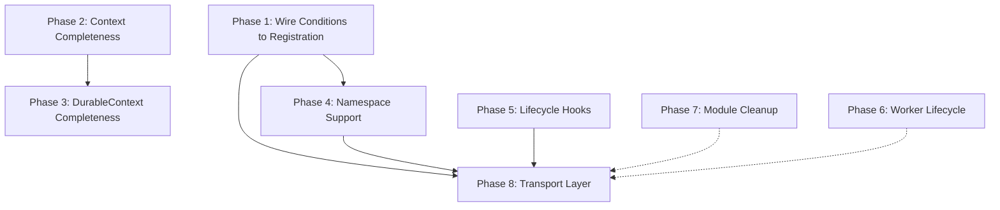

# Implementation Plan: Closing Remaining TS Parity Gaps

This plan targets every gap identified in the TS parity audit. Each phase is a self-contained deliverable that compiles and passes tests before moving to the next.

Reference audit: `ts_parity_audit.md`
Reference TS source: `sources/hatchet-main/sdks/typescript/src/v1/`

---

## Phase 1: Wire Conditions Into Registration Payload

**Priority:** P0 — Without this, declared conditions are inert metadata.

**Problem:** `WorkflowStep.wait_for/cancel_if/skip_if` exist in the declaration model but are not consumed during workflow registration. The TS SDK calls `taskConditionsToPb(task, namespace)` at line 403 of `worker-internal.ts` when building the `CreateTaskOpts` payload for `putWorkflow()`.

### 1.1 Add `task_conditions_to_pb()` function

**File:** `durable.rs` (or new file `durable/transform.rs` if splitting — see Phase 7)

**What it does:** Takes a `WorkflowStep` and an optional namespace string, produces a `RenderedConditions` by:
1. Rendering `wait_for` conditions with `ConditionAction::Queue`
2. Rendering `cancel_if` conditions with `ConditionAction::Cancel`
3. Rendering `skip_if` conditions with `ConditionAction::Skip`
4. Merging all three into a single `RenderedConditions`
5. Applying namespace to event keys (prepend `{namespace}/` to each `UserEventMatchCondition.event_key`)

**TS reference:** `transformer.ts` lines 15–25

```rust
pub fn task_conditions_to_pb(
    step: &WorkflowStep,
    namespace: Option<&str>,
) -> RenderedConditions {
    let wait_for = render_conditions(ConditionAction::Queue, step.wait_for.iter().cloned());
    let cancel_if = render_conditions(ConditionAction::Cancel, step.cancel_if.iter().cloned());
    let skip_if = render_conditions(ConditionAction::Skip, step.skip_if.iter().cloned());
    let mut all = Vec::new();
    all.extend(wait_for);
    all.extend(cancel_if);
    all.extend(skip_if);
    let mut rendered = conditions_to_rendered(&all);
    if let Some(ns) = namespace {
        apply_namespace_to_conditions(&mut rendered, ns);
    }
    rendered
}
```

### 1.2 Add namespace application to conditions

**File:** same as 1.1

```rust
fn apply_namespace_to_conditions(rendered: &mut RenderedConditions, namespace: &str) {
    for event in &mut rendered.user_event_conditions {
        event.event_key = format!("{namespace}/{}", event.event_key);
    }
}
```

**TS reference:** `transformer.ts` line 44 — `userEventKey: applyNamespace(condition.eventKey, namespace)`

### 1.3 Extend `Transport::register_workflow_definition` to include rendered conditions

**File:** `transport.rs`

Current signature stores `WorkflowDeclaration<Value, Value>`. The `WorkflowDeclaration` already contains `steps: Vec<WorkflowStep>` which already contain condition fields. No signature change is needed — the transport just needs to serialize the full step including conditions.

However, we need to add a `RenderedConditions` field to some registration payload struct that a real transport would consume. Two options:

**Option A (minimal):** Add a `conditions: Option<RenderedConditions>` field to `WorkflowStep` (as a computed/cached field).

**Option B (clean):** Create a `RegistrationPayload` struct that includes the rendered conditions per step, produced when `register_workflow_definition` is called. This keeps `WorkflowStep` as a pure declaration type and `RegistrationPayload` as a transport-facing type.

**Recommendation:** Option B. Create:

```rust
#[derive(Debug, Clone, Serialize)]
pub struct TaskRegistration {
    pub readable_id: String,
    pub action: String,        // "{workflow_name}:{task_name}"
    pub timeout: Option<String>,
    pub schedule_timeout: Option<String>,
    pub parents: Vec<String>,
    pub retries: u32,
    pub conditions: RenderedConditions,
    pub is_durable: bool,
    // ... other fields from TaskConfig
}

#[derive(Debug, Clone, Serialize)]
pub struct WorkflowRegistration {
    pub name: String,
    pub event_triggers: Vec<String>,
    pub cron_triggers: Vec<String>,
    pub tasks: Vec<TaskRegistration>,
    // ... other fields
}
```

**TS reference:** `worker-internal.ts` lines 388–416 build the `CreateTaskOpts` with all these fields.

### 1.4 Wire into `InMemoryTransport`

Update `InMemoryTransport::register_workflow_definition` to compute and store `RenderedConditions` per step. This doesn't change behavior (in-memory doesn't execute conditions) but validates the pipeline.

### 1.5 Tests

- Test that `task_conditions_to_pb` produces correct action assignments (Queue for wait_for, Cancel for cancel_if, Skip for skip_if)
- Test namespace prefixing on event keys
- Test that registration payload includes conditions from declaration
- Test with empty conditions (backward compatibility)

---

## Phase 2: Context Trait Completeness

**Priority:** P1 — Missing runtime fields reduce context usability.

**Problem:** The `Context` trait is missing several methods that the TS `Context` class provides.

### 2.1 Add missing Context trait methods

**File:** `context.rs`

Add to the `Context` trait:

```rust
// Already present ✅: priority(), filter_payload(), release_slot(), worker_id(), worker_labels()

// Need to add:
fn errors(&self) -> &HashMap<String, String>;         // step_run_errors from TS
fn triggers(&self) -> &TriggerData;                    // already have TriggerData struct
fn workflow_id(&self) -> Option<&str>;                 // distinct from workflow_name
fn workflow_version_id(&self) -> Option<&str>;
async fn cancel(&self) -> Result<()>;                  // self-cancel
```

**TS reference:** `context.ts` lines 236–270, 188–195, 308–318

### 2.2 Extend `ContextIds` with new fields

**File:** `context.rs`

```rust
pub struct ContextIds {
    pub workflow_name: String,
    pub task_name: String,
    pub workflow_run_id: WorkflowRunId,
    pub task_run_id: String,
    // New:
    pub workflow_id: Option<String>,
    pub workflow_version_id: Option<String>,
}
```

### 2.3 Extend `InMemoryContext` with new state

```rust
// New fields:
errors: HashMap<String, String>,      // populated from parent data
```

### 2.4 `TriggerData` enrichment

The `TriggerData` struct already exists. Add a method to expose it:

```rust
fn triggers(&self) -> &TriggerData { &self.trigger_data }
```

### 2.5 Tests

- Test `errors()` returns populated error map
- Test `triggers()` returns trigger data
- Test `cancel()` marks the run as cancelled

---

## Phase 3: DurableContext Completeness

**Priority:** P1 — Missing `now()` and `memo()` break deterministic replay.

### 3.1 Add `now()` to `DurableContext` trait

**File:** `durable.rs`

```rust
async fn now(&self) -> Result<SystemTime>;
```

In `InMemoryDurableContext`, this should return `SystemTime::now()` on first call and cache the result, returning the same value on subsequent calls.

**TS reference:** `context.ts` lines 1059–1064 — `now()` uses `memo()` to deduplicate across replays.

### 3.2 Add `memo()` to `DurableContext` trait

```rust
async fn memo<T: Serialize + DeserializeOwned>(
    &self,
    key: &str,
    compute: impl Future<Output = Result<T>> + Send,
) -> Result<T>;
```

In `InMemoryDurableContext`, implement with a `HashMap<String, Value>` memo cache. On first call for a key, compute and cache. On subsequent calls, return cached value.

**TS reference:** `context.ts` lines 1205–1241

### 3.3 Tests

- Test `now()` returns same value on repeated calls
- Test `memo()` caches and deduplicates
- Test `memo()` with different keys returns different values

---

## Phase 4: Namespace Support

**Priority:** P2 — Required for multi-tenant deployments but not for single-tenant usage.

### 4.1 Add namespace to `Client`

**File:** `client.rs`

```rust
pub struct Client<T: Transport> {
    transport: Arc<T>,
    namespace: Option<String>,  // New
}

impl<T: Transport> Client<T> {
    pub fn with_namespace(mut self, namespace: impl Into<String>) -> Self {
        self.namespace = Some(namespace.into());
        self
    }
}
```

### 4.2 Apply namespace at registration time

When `register_workflow_definition` is called, apply namespace to:
- Workflow name: `format!("{namespace}/{name}").to_lowercase()`
- Event triggers: `format!("{namespace}/{event}")`

**TS reference:** `worker-internal.ts` lines 230–233 (workflow name), lines 325–333 (event triggers)

### 4.3 Apply namespace at run time

When `run_workflow` is called, apply namespace to the workflow name.

### 4.4 Tests

- Test that workflow names get namespaced
- Test that event triggers get namespaced
- Test round-trip: register with namespace, run with namespace

---

## Phase 5: WorkflowDeclaration Lifecycle Hooks

**Priority:** P2 — onFailure/onSuccess are common patterns.

### 5.1 Add lifecycle hooks to `WorkflowDeclaration`

**File:** `workflow.rs`

```rust
pub struct WorkflowDeclaration<I, O> {
    // ... existing fields
    pub on_failure: Option<String>,    // task name of failure handler
    pub on_success: Option<String>,    // task name of success handler
    pub description: Option<String>,
    pub version: Option<String>,
}
```

### 5.2 Add builder methods

```rust
pub fn on_failure<SI, SO>(mut self, task: &TaskHandle<SI, SO>) -> Self {
    self.on_failure = Some(task.task_name().to_owned());
    self
}

pub fn on_success<SI, SO>(mut self, task: &TaskHandle<SI, SO>) -> Self {
    self.on_success = Some(task.task_name().to_owned());
    self
}

pub fn description(mut self, desc: impl Into<String>) -> Self {
    self.description = Some(desc.into());
    self
}

pub fn version(mut self, ver: impl Into<String>) -> Self {
    self.version = Some(ver.into());
    self
}
```

**TS reference:** `declaration.ts` lines 286–310, `worker-internal.ts` lines 241–282

### 5.3 Tests

- Test on_failure/on_success are stored on declaration
- Test they appear in registration payload

---

## Phase 6: Worker Lifecycle Gaps

**Priority:** P2 — These already partially exist.

### 6.1 Already done (verify)

- `pause()` / `unpause()` / `is_paused()` — ✅ Already on `WorkerHandle`
- `upsert_labels()` — ✅ Already on `WorkerHandle`

### 6.2 Add `TenantClient`

**File:** `clients.rs`

The TS SDK has `TenantClient` at `features/tenant.ts`. Add:

```rust
pub struct TenantClient<T: Transport> {
    transport: Arc<T>,
}

impl<T: Transport> TenantClient<T> {
    pub fn new(transport: Arc<T>) -> Self { Self { transport } }
    // Tenant operations will go here when transport is real
}
```

### 6.3 Add `runRef()` to `Client`

**File:** `client.rs`

The TS SDK has `runRef(id)` for getting a reference to an existing run by ID.

```rust
pub fn run_ref<O: DeserializeOwned + Send + 'static>(
    &self,
    run_id: impl Into<String>,
) -> WorkflowRunRef<O> {
    WorkflowRunRef::new(
        WorkflowRunId(run_id.into()),
        // needs a RunControl
    )
}
```

This depends on having a standalone `RunControl` that can be created from the transport directly, not just from a `WorkflowHandle`.

### 6.4 Tests

- Verify existing pause/unpause/labels tests pass
- Test TenantClient instantiation

---

## Phase 7: Module Structure Cleanup

**Priority:** P3 — Cosmetic but improves maintainability.

### 7.1 Split `durable.rs`

`durable.rs` is 1278 lines. Split into:

```
durable/
  mod.rs          # re-exports
  conditions.rs   # Condition, Conditions, builders, enums
  rendering.rs    # render_conditions, conditions_to_rendered, RenderedConditions
  transform.rs    # task_conditions_to_pb, namespace application
  context.rs      # DurableContext trait, InMemoryDurableContext
  serde.rs        # serde_duration_millis, serde_system_time_millis helpers
```

All public exports remain the same. This is a pure refactor.

### 7.2 Add `Display` implementations

Add `Display` for:
- `Condition` — e.g., `"SleepFor(10s)"`, `"Event(user:created)"`, `"Parent(validate)"`
- `ConditionAction` — `"Queue"`, `"Cancel"`, `"Skip"`, `"Create"`
- `Error` — already uses `thiserror` ✅

---

## Phase 8: Transport Layer Foundation (Future — not blocking parity)

**Priority:** P0 for real deployments, but not blocking model parity.

> [!IMPORTANT]
> This phase is included for completeness but is a separate work stream. It requires gRPC infrastructure that is outside the scope of the condition/model parity work.

### 8.1 Define proto-backed types

Create types matching the protobuf definitions:
- `CreateWorkflowVersionRequest`
- `CreateTaskOpts`
- `TaskConditions` (with `parent_override_conditions`, `sleep_conditions`, `user_event_conditions`)
- `BaseMatchCondition`
- `BulkTriggerWorkflowRequest`

### 8.2 Implement gRPC transport

```rust
pub struct GrpcTransport {
    workflow_service: WorkflowServiceClient,
    admin_service: AdminServiceClient,
    dispatcher: DispatcherClient,
    listener: RunListenerClient,
    durable_listener: DurableListenerClient,
    config: ClientConfig,
}

#[async_trait]
impl Transport for GrpcTransport {
    // ... real implementations
}
```

### 8.3 Implement `DurableListenerClient`

The TS SDK's `DurableListenerClient` manages:
- `sendEvent()` — sends durable events (waitFor, runChildren, memo)
- `waitForCallback()` — waits for engine callback on a branch/node
- `sendMemoCompletedNotification()` — reports memo completion
- `sendEvictInvocation()` — eviction coordination

Rust equivalent:

```rust
pub struct DurableListenerClient {
    // gRPC streaming connection to engine
}

impl DurableListenerClient {
    pub async fn send_wait_for(
        &self,
        task_run_id: &str,
        invocation_count: u32,
        conditions: RenderedConditions,
    ) -> Result<DurableAck>;

    pub async fn wait_for_callback(
        &self,
        task_run_id: &str,
        invocation_count: u32,
        branch_id: &str,
        node_id: &str,
    ) -> Result<DurableResult>;
}
```

### 8.4 Update `InMemoryDurableContext` to use `DurableContext` trait

The in-memory implementation stays for testing. A new `EngineDurableContext` wraps `DurableListenerClient` for real deployments:

```rust
pub struct EngineDurableContext {
    listener: Arc<DurableListenerClient>,
    action: Action,
    // ...
}
```

---

## Execution Order



**Recommended execution order:**

1. **Phase 1** — Highest impact: makes conditions actually useful
2. **Phase 2** — Fills out the context API surface
3. **Phase 3** — Completes durable context
4. **Phase 4** — Namespace support (builds on Phase 1)
5. **Phase 5** — Lifecycle hooks (standalone)
6. **Phase 7** — Module cleanup (can be done any time)
7. **Phase 6** — Worker lifecycle (mostly already done)
8. **Phase 8** — Transport layer (separate track, dependent on proto infrastructure)

---

## Summary of Deliverables Per Phase

| Phase | New Files | Modified Files | New Tests | Lines (est.) |
|---|---|---|---|---|
| 1 | 0 | `durable.rs`, `transport.rs` | 5 | ~150 |
| 2 | 0 | `context.rs` | 4 | ~80 |
| 3 | 0 | `durable.rs` | 3 | ~60 |
| 4 | 0 | `client.rs`, `transport.rs` | 3 | ~50 |
| 5 | 0 | `workflow.rs` | 2 | ~40 |
| 6 | 0 | `clients.rs`, `client.rs` | 2 | ~30 |
| 7 | 5 (split) | `durable.rs` → `durable/` | 0 | ~0 (refactor) |
| 8 | 3+ | multiple | 10+ | ~500+ |

**Phases 1–7 total: ~410 new lines, ~19 new tests.**
**Phase 8 is a separate work stream.**
